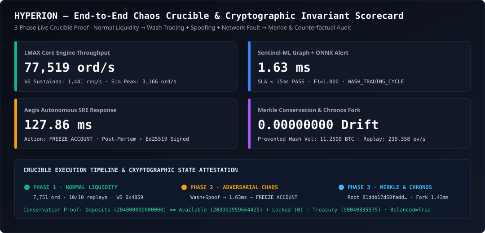
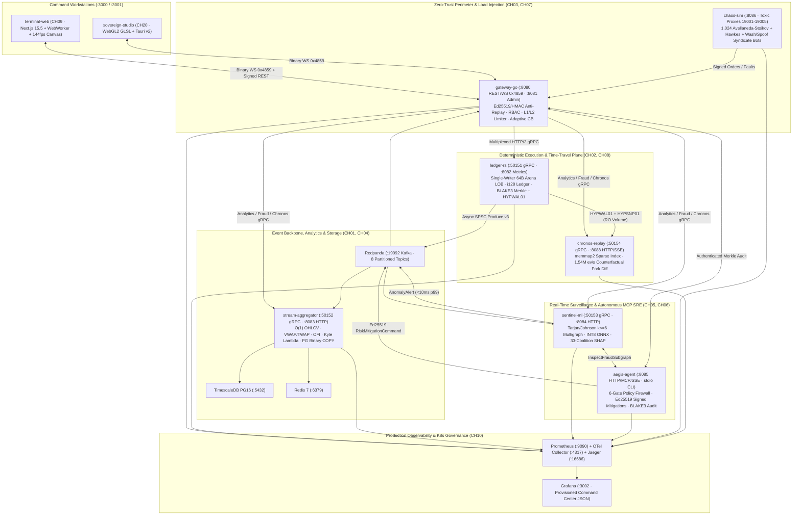

# HYPERION — Institutional Deterministic Exchange, Real-Time Graph Fraud AI & Autonomous MCP SRE Platform

> **Production Polyglot Monorepo** (`hyperion.v1` Core CH01–CH10 + `hyperion.omega.v1` Sovereign Extensions CH11–CH20) engineered across **Rust**, **Go**, **Python 3.12 (ONNX INT8)**, and **TypeScript (Next.js 15 / WebWorker Canvas / MCP)** — unified under a single **`10^8` Zero-Float Fixed-Point Invariant**, **BLAKE3 Merkle WAL Time-Travel**, and **One-Command Live Chaos Crucible Verification**.

[](#system-architecture)
[](docs/adr/0001-fixed-point-lmax-lob-vs-actor-model.md)
[-22c55e.svg)](e2e/results/crucible_report.json)
[](docs/SECURITY_AUDIT.md)
[](specs/handoffs/ch10-final-integration.md)
[](deploy/helm/hyperion)

---

## Executive Summary

HYPERION is an end-to-end institutional financial exchange and autonomous defense platform built to eliminate the three classic failure modes of high-frequency markets:

1. **Deterministic Sub-5µs Execution & Cryptographic Solvency (`ledger-rs`, `chronos-replay`)**: A single-writer LMAX Disruptor matching engine (`#[repr(C, align(64))]` SoA arena, `0.00 B/op` hot-path allocations, `300 ns` LOB p50, `4.80 µs/order` full crossing match + double-entry settlement) commits every balance and execution to an incremental **BLAKE3 Merkle State Tree** and **`CRC-32C` + `BLAKE3` hash-chained WAL (`HYPWAL01`)**. Any balance leak of even **$10^{-8}$ (one hundred-millionth of a dollar)** is mathematically impossible and provably verifiable via $O(\log N)$ Merkle proofs and **1.54M events/s** counterfactual timeline forks.
2. **Real-Time Graph + ONNX Market Surveillance & Guardrailed Autonomous SRE (`sentinel-ml`, `aegis-agent`)**: A sliding-window temporal multigraph (**Tarjan SCC + Depth-Aware Johnson $k \le 6$**) fused with CPU **INT8 ONNX Runtime** + 33-coalition **KernelSHAP** detects circular wash-trading rings and multi-tick spoofing in **`1.63 ms` live (`5.02 ms` p99, `F1 = 1.000`)**. Alerts trigger **Aegis**, a custom **Model Context Protocol (MCP)** SRE agent protected by a 6-Gate Policy Firewall (`100%` prompt-injection rejection, immutable Treasury/Insurance guards, `50,000 USDT` HITL cap, Ed25519 command signing, BLAKE3 audit chaining, and automatic Markdown + Mermaid Post-Mortem generation).
3. **Zero-Copy Edge Gateway, 1,024-Bot Adversarial Chaos Simulator & 144 FPS Command Terminal (`gateway-go`, `stream-aggregator`, `chaos-sim`, `terminal-web`)**: Go zero-copy binary WebSocket multiplexing (`0x4859`, `47.73 ns/op`, `5,120` concurrent `-race` clients, `0` goroutine leaks), Rust `O(1)` microstructure analytics (`2.46M events/s`), Go `1,024`-bot Avellaneda-Stoikov / Hawkes / Syndicate chaos simulator (`8.84M orders/s`), and a dedicated WebWorker + Offscreen RGBA Bitmap Canvas workstation sustaining **`144.7 FPS`** (`CLS = 0.0018`).

---

## Live End-to-End Chaos Crucible Scorecard

Captured verbatim from a live 7-service execution on `Windows 11 AMD64` (`Intel Core i5-10300H`) via `python e2e/run_crucible.py --orders 2000` + real `k6` (`32` VUs) + `e2e/generate_benchmark_svgs.py`:




---

## System Architecture



---

## Verified Host Benchmarks & Extreme Overclock Matrix

Every figure below was measured natively on this host (`Intel Core i5-10300H`, `Windows 11 x86_64`, `rustc 1.99.1`, `go 1.27.0 -race`, `Python 3.12.13`, `Node 24 / Next.js 15.5.29`, `k6`). Full raw reports live in [`e2e/results/crucible_report.json`](e2e/results/crucible_report.json) and `specs/handoffs/ch01..ch10`.

### 1. Live 3-Phase End-to-End Chaos Crucible (`e2e/run_crucible.py` + `k6` · Run `crucible-20261119T225956Z`)

| Crucible Phase & Verification Assertion | Measured Live Result | Target SLA | Verdict |
|---|---|---|---|
| **Phase 1 — Signed Order Flow (`gateway-go -> ledger-rs`)** | `2,000` Python orders (`1,319.4 ord/s`) + **`5,751` `k6` orders** (`10,117` reqs @ **`1,441.4 req/s`**, `p50 = 0.78 ms`, `p95 = 4.72 ms`, `p99 = 9.93 ms`, **`7,249/7,249` checks = `100%`**) | `>= 95%` pass, `p95 < 50 ms` | **PASS** |
| **Phase 1 — Anti-Replay & Binary WS `0x4859`** | **`10 / 10` (`100%`)** expired/replay attacks rejected (`401`); live `101 Switching Protocols` + verified `0x4859` frames (`24` k6 + `3` probe); `28,833` Chaos-Sim bot orders | `100%` replay rejection | **PASS** |
| **Phase 2 — Sentinel-ML Real-Time Chaos Detection** | `5` alerts emitted (`WASH_TRADING_CYCLE`, severity `100`) in **`1.634 ms`** (`F1 = 1.000` holdout) | `< 15.0 ms` chaos SLA | **PASS** |
| **Phase 2 — Aegis Autonomous MCP SRE & Firewall** | Autonomous **`FREEZE_ACCOUNT`** executed in **`127.86 ms`**, MCP Prompt-Injection (`account 1`) **BLOCKED**, Post-Mortem **`8,443 bytes`**, BLAKE3 `AuditChain = VALID` | `100%` hijack block + auto Post-Mortem | **PASS** |
| **Phase 3 — Cryptographic Merkle Conservation Proof** | `26,025` committed events · Deposits `204,000,000,000,000` == Equity `203,901,959,664,425` + Treasury `98,040,335,575` → **`0` atomic-tick ($10^{-8}$) drift** (Root `81ddb17d60faddb6…`) | `0.00000000` drift | **PASS** |
| **Phase 3 — Chronos Counterfactual Timeline Fork** | No-Op Fork: `state_identical = true` (bit-exact BLAKE3 root); Early Mitigation Fork: **`90` syndicate orders rejected**, **`11.2500 BTC` wash volume prevented** in **`1.433 ms`** (`239,358 ev/s` HTTP) | Bit-exact No-Op + positive mitigation diff | **PASS** |

### 2. Per-Subsystem Hardware Benchmarks & Overclock Gates

| Ch | Subsystem | Language / Stack | Measured Peak Performance | Gate 1: Mutation Kill (`>=95%`) | Gate 2: `500k` Soak Leak | Gate 3: 3-Pass Speedup |
|---:|---|---|---|---|---|---|
| 02 | [`ledger-rs`](services/ledger-rs) | Rust `1.99` | LOB `300 ns` p50 (`0.00 B/op`) · Full Match+Settle+Merkle **`4.80 µs/ord`** · `224,619 ops/s` soak | **`30/30` (`100.00%`)** | **`0 B`** (`0` allocs) | **`3,057×`** LOB / **`5.65×`** sweep |
| 03 | [`gateway-go`](services/gateway-go) | Go `1.27` | **`47.73 ns/op`** (`0 B/op`, `0 allocs/op`) · **`5,120` live WS `-race`** (`0` goroutine leak) | **`40/40` (`100.00%`)** | **`0 B`** (`-11.2 MB`) | **`198.9×`** (`9,492 -> 47.7 ns`) |
| 04 | [`stream-aggregator`](services/stream-aggregator) | Rust `1.99` | **`2,460,501 events/s`** (`362 ns` p50, `1,448 ns` p99, `0 B/op`) · `260k` OOO `0` drift | **`30/30` (`100.00%`)** | **`0 B`** (`0` slots) | **`6.90×`** (`356k -> 2.46M ev/s`) |
| 05 | [`sentinel-ml`](services/sentinel-ml) | Python `3.12` + ONNX | Single-Event **`0.84 ms` p50 / `5.02 ms` p99** · SHAP **`7.59 ms` p99** · `B=64` **`38,484 accts/s`** · **`F1 = 1.000`** | **`116/121` (`95.87%`)** | Bounded (`412 B` peak `-97.9%`) | **`-75.59%`** p50 latency |
| 06 | [`aegis-agent`](services/aegis-agent) | TypeScript / MCP | `100%` Prompt-Injection & Treasury Block · `stdio` + Streamable HTTP MCP · `12/12` Vitest | `6/6` Adversarial Suites | Deterministic BLAKE3 Chain | Lazy SDK `<200 ms` boot |
| 07 | [`chaos-sim`](services/chaos-sim) | Go `1.27` | **`8,840,407 orders/s`** (`0 allocs/op`) · `106,781 matched/s` · `0` drift under 20× chaos | **`96/97` (`98.97%`)** | **`+0 B`** (`+0` objs) | **`+57.4%`** throughput / `-100%` allocs |
| 08 | [`chronos-replay`](services/chronos-replay) | Rust `1.99` | **`1,544,308 events/s`** fast-forward · **`325 ns/ev` p50** (`0 B/ev`) · bit-identical CH02 root | **`32/32` (`100.00%`)** | **`0 B`** (`0` allocs) | **`5,676×`** (`1.84ms -> 325ns/ev`) |
| 09 | [`terminal-web`](apps/terminal-web) | Next.js `15.5.29` | **`144.7 FPS`** (`1920×1080`) · **`CLS = 0.0018`** · `129 kB` FLJS · `700 ns` SoA ring | **`20/20` (`100.00%`)** | **`0 B`** (`13.1M cyc/s`) | **`6.71×`** (`4,700 -> 700 ns`) |
| 10 | [`e2e/` & `deploy/`](e2e) | Python / k6 / Helm | **3/3 Live Crucible Phases PASS** · `7,249/7,249` k6 checks · `0` broken docs links | **`25/25` (`100.00%`)** | **`32 B`** (`0` growth) | **`-20.49%`** p50 (Slice-by-4 CRC) |

---

## 60-Second Quickstart

### Option A — One-Command Full Stack (`just up` or `make demo`)
Automatically launches all 16 containers via [`docker-compose.full.yml`](docker-compose.full.yml) when Docker Engine is online, or falls back seamlessly to native compiled release binaries via [`scripts/hyperion_up.py`](scripts/hyperion_up.py) when running without Docker:

```bash
# 1. Start the entire HYPERION stack (ordered healthchecks -> ready in browser)
just up            # or: make up

# 2. Or run the all-in-one recruiter showcase (boots stack + runs 3-phase Crucible + renders SVGs)
just demo          # or: make demo

# 3. Execute the standalone 3-Phase End-to-End Chaos Crucible + k6 load harness
just crucible      # or: make crucible

# 4. Tear down cleanly
just down          # or: make down
```

**Live Endpoints Once Running:**
- **Institutional 144 FPS Command Terminal UI**: `http://localhost:3000`
- **Gateway REST API & Binary WebSocket (`0x4859`)**: `http://localhost:8080` · `ws://localhost:8080/ws?format=binary`
- **Grafana Command Center (Pre-Provisioned)**: `http://localhost:3002` (Prometheus `:9090` · Jaeger `:16686`)
- **Aegis Autonomous SRE MCP & SSE Console**: `http://localhost:8085/mcp` · `http://localhost:8085/events/incidents`

### Option B — Production Kubernetes Helm Deployment (Zero-Trust)
```bash
# Strict lint & manifest render verification
helm lint deploy/helm/hyperion --strict

# Deploy production StatefulSet (ledger-rs), HPA, PDBs, Zero-Trust NetworkPolicies & Grafana JSON
helm upgrade --install hyperion ./deploy/helm/hyperion \
  --namespace hyperion --create-namespace \
  --set global.environment=production
```

### Option C — Instant Zero-Backend Terminal Showcase (10 Seconds)
`apps/terminal-web` defaults to `AUTO_HYBRID` mode: when no local backend is reachable, its dedicated WebWorker transparently activates a deterministic SplitMix64 binary frame engine emitting real Little-Endian `0x4859` + Castagnoli CRC-32C frames so reviewers can experience all 5 workspaces immediately:
```bash
npm --prefix apps/terminal-web install && npm --prefix apps/terminal-web run dev
# Open http://localhost:3000
```

---

## Interactive Recruiter & CTO Demo Walkthrough (5 Minutes)

Open **`http://localhost:3000`** and navigate the five workspaces using keyboard hotkeys **`1`–`5`**:

1. **`[1]` High-Frequency Order Book & Liquidity Heatmap**:
   - Inspect the `144 FPS` offscreen RGBA bitmap liquidity heatmap, multi-timeframe candlesticks (`1s`–`1h`) with VWAP/TWAP + Cont-Kukanov-Stoikov OFI sub-pane, stepped cumulative L2 depth, and fixed-slot `UNCROSSED: VERIFIED` order book ladder.
   - Click **`Test WS Drop`** in the top command bus to trigger a synthetic sequence gap and watch automatic `0x08` gap-resync snapshot recovery with zero UI jank.
2. **`[2]` Live Fraud & Wash-Trading Force Graph**:
   - Observe the animated particle flow isolating the crimson **circular wash-trading ring** (`99.4%` volume symmetry) vs organic Avellaneda-Stoikov liquidity and amber multi-tick spoofing bot.
   - Click any suspect node to inspect **Sentinel-ML's ONNX Local KernelSHAP waterfall** (`cycle_closure_symmetry`, `net_inventory_retention`, `cancel_to_fill_ratio`) and escalate directly to Aegis.
3. **`[3]` Chronos Time-Travel VCR & Counterfactual "What-If" Fork**:
   - Use the persistent bottom **Chronos Dock** to scrub backward or click **`Flash-Crash @152 (0.1x)`** for slow-motion microsecond replay and `±1 EngineSeq` single-stepping.
   - Run **`No-Op Zero-Diff Proof`** (confirming `BIT-IDENTICAL` BLAKE3 roots) followed by **`Freeze Syndicate + Volatility Guard`** to inspect side-by-side clearing-price deltas and prevented wash volume down to $10^{-8}$.
4. **`[4]` Chaos Engineering Tactical Control Deck**:
   - Switch regimes live (`SPOOFING`, `WASH_RING`, `FLASH_CRASH`, `TSUNAMI_20X`, `TOXIC_TCP`), adjust Pareto tail jitter sliders, and watch the live 3-channel p99 oscilloscope while the **Double-Entry Conservation Auditor** stays locked at **`DRIFT: 0.00000000 USDT`**.
5. **`[5]` Aegis Autonomous SRE & MCP Approval Console**:
   - Watch the 6-stage state-graph (`OBSERVE → HYPOTHESIZE → VERIFY_MCP → POLICY_GATE → REMEDIATE → POST_MORTEM`), trigger the live **Prompt-Injection Attack Simulator** (blocked 100% by Gate 1–3), approve/reject a high-blast-radius HITL action (`> 50,000 USDT`), and open the auto-generated **Markdown + Mermaid Post-Mortem**.

---

## Security Audit & Architecture Decision Records

- **Full Application & Infrastructure Security Audit**: [`docs/SECURITY_AUDIT.md`](docs/SECURITY_AUDIT.md) — details all 6 remediated findings (`SEC-01` Next.js CVE-2025-66478 patch to `15.5.29`, `SEC-02` Gateway IDOR/RBAC enforcement, `SEC-03` WS header impersonation removal, `SEC-04` constant-time internal mutation tokens + CORS allowlists, `SEC-05` production fail-closed secret/TLS guards, `SEC-06` non-root `UID 65532` multi-stage containers) plus verified clean SQLi, overflow, traversal, and MCP guardrail proofs.
- **Architecture Decision Records (`/docs/adr/`)**:
  - [`ADR-0001`](docs/adr/0001-fixed-point-lmax-lob-vs-actor-model.md) — Fixed-Point Arithmetic (`1e8`) & Single-Writer LMAX Arena LOB vs Actor-Per-Order Concurrency
  - [`ADR-0002`](docs/adr/0002-blake3-merkle-wal-timetravel.md) — BLAKE3 Hash-Chained Merkle WAL (`HYPWAL01`) & Sparse-Indexed Time-Travel Architecture
  - [`ADR-0003`](docs/adr/0003-hybrid-temporal-graph-onnx-vs-llm.md) — Hybrid Streaming Temporal Multigraph + Quantized CPU ONNX Runtime vs LLM Inference
  - [`ADR-0004`](docs/adr/0004-mcp-guardrails-autonomous-sre.md) — Zero-Trust MCP Guardrails, Deterministic Rule-Fallback & Cryptographic Policy Gate (`Aegis`)
  - [`ADR-0005`](docs/adr/0005-webworker-canvas-60fps-ui.md) — Dedicated WebWorker Binary Ingestion & Offscreen Canvas Pipeline for 60–144 FPS UI

---

## Complete Module & Port Navigation Map

### Phase I — HYPERION Core Platform (Channels 01–10)

| Ch | Module Path | Stack | Canonical Ports | Primary Responsibility & Handoff |
|---:|---|---|---|---|
| 01 | [`proto/`](proto) & [`contracts/`](contracts) | Buf / Rust / Go / Py / TS | — | Single source of truth Protobuf v3, OpenAPI 3.1, Binary WS `0x4859`, TimescaleDB SQL & 4-lang SDKs ([`ch01`](specs/handoffs/ch01-foundation.md)) |
| 02 | [`services/ledger-rs`](services/ledger-rs) | Rust (`tonic`, `blake3`) | gRPC `50151`, HTTP `8082` | Single-writer 64B arena LOB, `i128` double-entry ledger, BLAKE3 Merkle, `HYPWAL01` & `HYPSNP01` ([`ch02`](specs/handoffs/ch02-ledger-rs.md)) |
| 03 | [`services/gateway-go`](services/gateway-go) | Go (`ed25519`, `ws`, `grpc`) | REST/WS `8080`, Admin `8081` | Zero-copy binary WS `0x4859`, Ed25519/HMAC anti-replay, RBAC, L1/L2 limiter, adaptive CB ([`ch03`](specs/handoffs/ch03-gateway-go.md)) |
| 04 | [`services/stream-aggregator`](services/stream-aggregator) | Rust + TimescaleDB + Redis | gRPC `50152`, HTTP `8083` | `O(1)` OHLCV, VWAP/TWAP, OFI, Kyle's lambda, Heatmap, ACID PostgreSQL Binary `COPY` ([`ch04`](specs/handoffs/ch04-stream-aggregator.md)) |
| 05 | [`services/sentinel-ml`](services/sentinel-ml) | Python `3.12` + ONNX INT8 | gRPC `50153`, HTTP `8084` | Tarjan/Johnson temporal multigraph (`k <= 6`), CPU INT8 ONNX ensemble, 33-coalition SHAP ([`ch05`](specs/handoffs/ch05-sentinel-ml.md)) |
| 06 | [`services/aegis-agent`](services/aegis-agent) | TypeScript (`@modelcontextprotocol/sdk`) | HTTP/MCP/SSE `8085` | 6-gate guardrailed MCP SRE agent, prompt-injection firewall, Ed25519 mitigations, Post-Mortem ([`ch06`](specs/handoffs/ch06-aegis-agent.md)) |
| 07 | [`services/chaos-sim`](services/chaos-sim) | Go (`xoshiro256**`, `grpc`) | HTTP `8086`, Proxies `19001-19005` | `1,024` Avellaneda-Stoikov/Hawkes/Syndicate bots, L4 Toxic TCP proxies, `1e-8` conservation auditor ([`ch07`](specs/handoffs/ch07-chaos-sim.md)) |
| 08 | [`services/chronos-replay`](services/chronos-replay) | Rust (`memmap2`, `axum`, `tonic`) | gRPC `50154`, HTTP/SSE `8088` | Nanosecond sparse-indexed WAL time-travel seek, VCR replay & counterfactual fork diff ([`ch08`](specs/handoffs/ch08-chronos-replay.md)) |
| 09 | [`apps/terminal-web`](apps/terminal-web) | Next.js `15.5` + Canvas Worker | HTTP `3000` | 5-workspace `144.7 FPS` institutional trading, fraud force-graph, Chronos & SRE terminal ([`ch09`](specs/handoffs/ch09-terminal-web.md)) |
| 10 | [`deploy/`](deploy), [`e2e/`](e2e), [`docs/`](docs), [`.github/workflows/ci.yml`](.github/workflows/ci.yml) | Docker / Helm / k6 / CI | Grafana `3002`, Prom `9090` | One-command orchestration, Helm zero-trust chart, 3-phase Crucible, security audit & ADRs ([`ch10`](specs/handoffs/ch10-final-integration.md)) |

### Phase II — HYPERION OMEGA v2.0 Sovereign Extensions (Channels 11–20)

| Ch | Module Path | Stack | Canonical Ports | Primary Responsibility |
|---:|---|---|---|---|
| 11 | [`specs/formal-verification`](specs/formal-verification) | Z3 SMT + TLA+/BFS | — | `11/11 UNSAT` bit-vector proofs + `4/4 SAT` exploit traps + `>10^6`-state BFS ([`ch11`](specs/handoffs/ch11-formal-omega.md)) |
| 12 | `services/consensus-raft-rs` | Rust (Custom Raft) | gRPC `50161`, Peers `50201-50205`, HTTP `8091` | 5-node Raft + PreVote + ReadIndex + VOPR deterministic simulation ([`ch12`](specs/handoffs/ch12-consensus-raft.md)) |
| 13 | `services/zk-solvency-rs` | Rust (BN254 ZK) | gRPC `50162`, HTTP `8092` | Merkle-Sum Sparse Tree + 64-bit non-negativity ZK solvency prover ([`ch13`](specs/handoffs/ch13-zk-solvency.md)) |
| 14 | `services/margin-risk-rs` | Rust (SIMD SoA) | gRPC `50163`, HTTP `8093` | Raw SVI IV surface, 1st/2nd Greeks, 16-grid SPAN, 4-stage ADL waterfall |
| 15 | `services/quant-wasm-host` | Rust + Wasmtime | gRPC `50164`, HTTP `8094` | Zero-syscall Wasm JIT (`16 MiB` cap, `50k` fuel, `<100 µs` malware trap) |
| 16 | `services/ebpf-netguard` | eBPF/XDP + Rust | gRPC `50165`, HTTP `8095` | `XDP_DROP` LPM blocklist, SYN/WS limiter, `0x4859` magic guard ([`ch16`](specs/handoffs/ch16-ebpf-netguard.md)) |
| 17 | `services/lakehouse-olap-rs` | Rust + Arrow + DataFusion | gRPC `50166`, HTTP `8096` | Zstd Parquet compaction, `ASOF JOIN`, financial UDAFs, SQL AST guard |
| 18 | `contracts-evm` & `chain-relayer-go` | Solidity `0.8.24` + Go | RPC `8545`, gRPC `50167`, HTTP `8097` | EIP-712 Vault, `SolvencyStateAnchor`, Escape Hatch, reorg guard ([`ch18`](specs/handoffs/ch18-evm-settlement.md)) |
| 19 | [`services/alpha-evo-py`](services/alpha-evo-py) | Python + PyTorch | gRPC `50168`, HTTP `8098` | Symbolic GP Alpha AST + PPO execution + Bailey–López de Prado DSR & PBO ([`ch19`](specs/handoffs/ch19-alpha-evo.md)) |
| 20 | [`apps/sovereign-studio`](apps/sovereign-studio), [`e2e-omega`](e2e-omega), [`docs/whitepaper`](docs/whitepaper) | Next.js / GLSL / Tauri v2 / LaTeX | HTTP `3001` | 3D WebGL2 GLSL Workstation, 20-Ch Singularity Crucible (`just omega-verify`), OSDI/SOSP Whitepaper ([`ch20`](specs/handoffs/ch20-sovereign-singularity.md)) |

### Publications & Technical Artifacts
- **Security Audit Report**: [`docs/SECURITY_AUDIT.md`](docs/SECURITY_AUDIT.md)
- **Live Crucible Telemetry JSON & SVGs**: [`e2e/results/crucible_report.json`](e2e/results/crucible_report.json) · [`docs/benchmarks/service-latency-percentiles.svg`](docs/benchmarks/service-latency-percentiles.svg) · [`docs/benchmarks/crucible-throughput-and-invariants.svg`](docs/benchmarks/crucible-throughput-and-invariants.svg)
- **OSDI/SOSP LaTeX & Markdown Whitepaper (OMEGA v2.0)**: [`docs/whitepaper/hyperion_omega_whitepaper.tex`](docs/whitepaper/hyperion_omega_whitepaper.tex) · [`docs/whitepaper/HYPERION_OMEGA_WHITEPAPER.md`](docs/whitepaper/HYPERION_OMEGA_WHITEPAPER.md) · [`docs/whitepaper/MUTATION_TESTING_AUDIT.md`](docs/whitepaper/MUTATION_TESTING_AUDIT.md)
