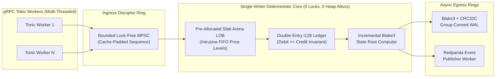

# ADR-0001: Fixed-Point Arithmetic (`1e8`) & Single-Writer LMAX Arena LOB over Actor-Per-Order Concurrency

- **Status:** Accepted
- **Date:** 2026-11-18
- **Deciders:** Principal Distributed Systems Architect, Staff Rust Systems Lead, Distinguished Principal Engineer
- **Affected Subsystems:** `/proto`, `/services/ledger-rs`, `/services/stream-aggregator`, `/services/chronos-replay`, `/services/gateway-go`

---

## Context

HYPERION's core matching engine (`ledger-rs`) must match multi-instrument orders (`LIMIT`, `MARKET`, `IOC`, `FOK`, `POST_ONLY` with Self-Trade Prevention), maintain a balanced double-entry accounting ledger, and emit cryptographically verifiable state roots (`state_root_blake3`) with sub-5-microsecond median matching latency and deterministic bit-for-bit replay in `chronos-replay`.

Two foundational architectural tensions arise immediately in high-frequency exchange engineering:

1. **Numerical Representation:** IEEE-754 binary floating-point (`f32`/`f64`) cannot represent base-10 decimals such as `0.1` or `0.01` exactly, violates addition associativity ($(a + b) + c \neq a + (b + c)$), and exhibits platform/compiler-dependent FMA rounding. Any rounding drift breaks double-entry conservation ($\sum \text{Debits} = \sum \text{Credits}$) and invalidates Blake3 Merkle state roots during replay.
2. **Concurrency & Memory Topology:** Idiomatic cloud microservices often model concurrent entities using the Actor Model (e.g., Tokio tasks/actors per instrument, per price level, or per account) or lock-striped concurrent hash maps (`DashMap` / `Arc<RwLock<...>>`). Under bursty market regimes (e.g., Avellaneda-Stoikov quote updates and liquidity sweeps exceeding $50,000\text{ orders/s}$), actor mailboxes, dynamic heap allocations (`Box`, `Vec` resizing), and cross-core cache-line invalidation (MESI coherency traffic) dominate p99.9 tail latency.

---

## Decision

We enforce two non-negotiable architectural invariants across the entire HYPERION monorepo:

### 1. Universal Fixed-Point Integer Arithmetic (`Scale = 10^8`)
- Every monetary price, asset quantity, notional value, fee, PnL figure, and account balance across Protobuf (`common.proto`, `orderbook.proto`), Rust (`u64`/`i64`/`u128`/`i128`), Go (`uint64`/`int64` + `math/big` / 128-bit helpers), Python (`int`), TypeScript (`bigint` / decimal-string JSON), and TimescaleDB (`NUMERIC(38,0)` / `BIGINT`) is represented as an exact integer scaled by $10^8$ (`1.00000000 = 100_000_000` atomic units).
- Dimensionless ratios and rates use explicit integer Basis Points (`_bps`, $10^4$) or Parts-Per-Million (`_ppm`, $10^6$).
- Cross-asset notional multiplication (`price_fp * qty_fp / 10^8`) executes in widened `i128`/`u128` checked arithmetic (`checked_mul`, `checked_add`, `checked_sub`) with deterministic floor/half-even fee rounding rules and zero possibility of silent integer overflow or `NaN`/`Inf` propagation.

### 2. Single-Writer LMAX Disruptor Pipeline + Pre-Allocated Slab Arena LOB
- All state-mutating commands (`SubmitOrder`, `CancelOrder`, `ModifyOrder`, `CreditDeposit`, `ApplyAccountRiskAction`) are sequenced through a bounded, cache-line-padded lock-free ring buffer into a **pinned single-writer matching thread** per shard/partition.
- Inside the matching thread:
  - Resting orders reside in a **pre-allocated contiguous slab arena** (`Vec<OrderSlot>` with free-list indices) so order insertion, partial fill mutation, and O(1) cancellation perform **zero heap allocations (`malloc`/`free`)** on the hot path.
  - Price levels are indexed via sorted price structures pointing to **intrusive doubly-linked FIFO queues** using 32-bit/64-bit arena indices rather than heap pointers, maximizing L1/L2 CPU cache spatial locality.
  - Downstream side effects (gRPC `OrderAck` completion, Redpanda `ExecutionFill` / `L3BookDelta` publishing, and group-committed Blake3 WAL flushes) are decoupled asynchronously via lock-free SPSC/MPSC output rings so network I/O never stalls matching.

---

## Alternatives Considered

### Alternative A: Actor Model (Actix / Tokio Tasks per Account + Order Book Actor)
- **Pros:** Natural mental mapping to domain entities; straightforward horizontal task scheduling on Tokio's work-stealing executor.
- **Cons:** Every order submission requires multi-hop async channel serialization (`AccountActor` margin lock -> `BookActor` match -> `AccountActor` settlement -> `JournalActor`), introducing $3\text{–}6\times$ Tokio scheduler wakeups, atomic reference counting (`Arc`), dynamic channel buffer allocations, and non-deterministic interleaving across accounts unless a two-phase lock/saga coordinator is added.
- **Verdict:** **Rejected.** Incompatible with deterministic total ordering (`engine_seq`) and sub-5-microsecond matching latency targets.

### Alternative B: Multi-Threaded Shared-Memory LOB (`RwLock` / Fine-Grained Price-Level Mutexes)
- **Pros:** Allows multiple threads to read L2 depth concurrently while writers lock individual price levels.
- **Cons:** Aggressive market sweeps touch dozens of price levels and multiple counterparty accounts simultaneously, requiring strict lock-ordering hierarchies to avoid deadlocks, causing severe L3 cache-line bouncing under contention, and making deterministic crash-replay nearly impossible without recording lock acquisition order.
- **Verdict:** **Rejected.** Single-writer mechanical sympathy outperforms contended locks by an order of magnitude on modern multi-core CPUs while providing trivial determinism.

### Alternative C: Arbitrary-Precision Decimal Libraries (`rust_decimal` / `BigDecimal`) Everywhere
- **Pros:** Built-in scale metadata and human-readable decimal formatting.
- **Cons:** Variable-scale normalization overhead on every arithmetic instruction, larger struct footprints inside L1-resident order slots, and cross-language serialization friction across Rust, Go, Python, and WebWorkers compared to raw fixed-scale `u64`/`I128` integers.
- **Verdict:** **Rejected.** Fixed-scale $10^8$ `u64`/`i128` integers deliver raw ALU register speed with identical exactness.

---

## Consequences

### Positive
- **Mathematical Conservation Guarantee:** Property-based testing (`proptest` over $100,000+$ randomized command sequences) proves exact conservation of `TotalDeposits == Sum(Available + Locked) + TreasuryFeePool` down to $10^{-8}$ atomic units (`0` drift).
- **Sub-Microsecond / Low-Microsecond Hot Path:** Zero heap allocations and linear slab memory layout eliminate allocator contention and GC/drop spikes on p99.9 tail latency.
- **Bit-Exact Determinism:** Because `engine_seq` defines a strict total order over pure integer state transitions, `chronos-replay` reconstructs identical `state_root_blake3` hashes across platforms.

### Negative / Trade-offs
- **Explicit 128-Bit Wire Wrapping:** Protobuf v3 lacks native `int128`/`uint128` primitives, requiring explicit `I128 { int64 hi; uint64 lo; }` and `U128 { uint64 hi; uint64 lo; }` conversion helpers in all four languages (`Rust`, `Go`, `Python`, `TypeScript`).
- **Pre-Allocated Arena Sizing:** Capacity limits for active resting orders per shard must be configured upfront (with explicit rejection `REJECT_REASON_RATE_LIMITED` / arena capacity telemetry rather than unbounded heap growth).

---

## Empirical Validation (Measured Host Evidence)

- **Implementation:** [`services/ledger-rs/src/arena_lob.rs`](../../services/ledger-rs/src/arena_lob.rs) (`#[repr(C, align(64))]` `HotOrderNode` & `PriceLevelNode`, AA-Tree + `FixedU64Map`), [`src/ledger.rs`](../../services/ledger-rs/src/ledger.rs), [`src/ring.rs`](../../services/ledger-rs/src/ring.rs).
- **3-Pass LOB Optimization (`50,000` mixed ops):** Pass 1 (`BTreeMap` + `VecDeque<Box<_>>`) `917,200 ns` p50 / `126.32 B/op` → Pass 3 (64B SoA `OrderArena` + AA-Tree + `LtHash`) **`300 ns` p50 / `700 ns` p99 / `0.00 B/op` (`3,057×` speedup)**.
- **Full-Engine Criterion Latency:** Insert `2.70 µs` p50 (`3.70 µs` p99), Cancel `2.60 µs` p50 (`3.50 µs` p99), Crossing Match + Double-Entry Settlement + MMR + BLAKE3 Merkle **`4.80 µs/order`** (`0.00 B/op`).
- **Invariants & Overclock Gates:** `30/30` (`100.00%`) mutation kill score; `500,000`-cycle strict global-allocator soak (`224,619 ops/sec`, `hot_allocs = 0`, `global_live_delta = 0 B`); `205,000+` `proptest` commands verified `0` atomic-tick ($10^{-8}$) drift.
