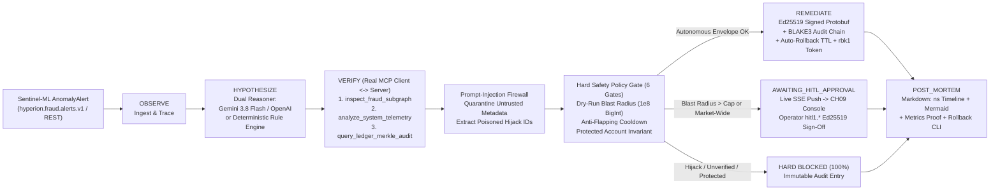

# CHANNEL 06 HANDOFF — AEGIS AUTONOMOUS INCIDENT-RESPONSE & FINANCIAL RISK CO-PILOT

- **Status**: `VERIFIED 100% — TYPECHECK, LINT, BUILD & ADVERSARIAL VITEST SUITE PASSING`
- **Service Directory**: `services/aegis-agent/` (Package: `aegis-mcp-server@1.0.0`, TypeScript `strict` ESM / Node.js `>=20`)
- **Upstream Contract Alignment**: Locked to `.agents/rules/00-hyperion-contract.md`, `specs/handoffs/ch01-foundation.md`, `/proto/{common,orderbook,telemetry_fraud}.proto`, `/contracts/gateway-openapi.yaml`, and `@hyperion/contracts` (`file:../../contracts/gen/ts`)
  - *Note*: At verification time, only `specs/handoffs/ch01-foundation.md` had landed in `specs/handoffs/` (`ch02`–`ch05` running concurrently in sibling worktrees); all ledger, gateway, and Sentinel-ML integrations strictly honor the canonical CH01 Protobuf/OpenAPI/port contracts.
- **Canonical Port Allocation**: `8085` (HTTP Control Plane `/api/v1/aegis/*`, Streamable HTTP MCP `/mcp`, Live SSE `/events/incidents`, `/healthz`, `/metrics`) + `stdio` MCP binary (`dist/cli-mcp.js` / `node dist/index.js --stdio`)

---

## 1. Architecture & Core Invariants

**Aegis** combines a production **Model Context Protocol (MCP) Server** (`@modelcontextprotocol/sdk`) with a deterministic **Autonomous State-Graph Investigation Engine** protected by a hard zero-trust **Safety Policy Engine**.



### Absolute Engineering Invariants Enforced
1. **Zero Floating-Point Monetary Math (`src/domain/fixed-point.ts`)**:
   - All prices, quantities, balances, notional volumes, fees, and policy caps (`max_auto_freeze_notional_fp = "5000000000000"` = `50,000.00000000 USDT`) execute exclusively in `bigint` scaled by `100_000_000n` ($10^8$).
   - Wire/JSON inputs are strictly validated by Zod regex (`^[0-9]{1,39}$` / `^-?[0-9]{1,39}$`), rejecting floating-point strings at protocol boundaries.
   - `1e8` decimal display formatting (`formatFixedPoint1e8`) and `ppm`/`bps` percentage rendering use pure integer division and modulo (zero IEEE-754 float math).
2. **Cryptographic Integrity (`src/crypto/`)**:
   - **BLAKE3 Merkle & Double-Entry Conservation Verifier (`merkle.ts`)**: Domain-separated (`0x00` leaf, `0x01` internal node) BLAKE3 binary Merkle proof verification plus exact conservation check $\sum(\text{Available} + \text{Locked}) + \text{TreasuryFeePool} \equiv \text{TotalDeposits} - \text{TotalWithdrawals}$ to `1` atomic tick ($10^{-8}$).
   - **Ed25519 Protobuf Command Signing (`signer.ts`)**: Serializes `RiskMitigationCommand` using `@hyperion/contracts`, signs the canonical unsigned Protobuf bytes with 64-byte Ed25519, embeds `ed25519Signature` + 32-byte `auditChainBlake3`, and attaches `X-Hyperion-*` HTTP auth headers per `00-hyperion-contract.md` §6.2.
   - **Signed Cryptographic Tokens**: `rbk1.<claims>.<ed25519_sig>` for instant mitigation rollbacks and `hitl1.<claims>.<ed25519_sig>` for human operator approvals.
   - **Immutable BLAKE3 + Ed25519 Hash-Chained Audit Log (`audit-chain.ts`)**: Every state transition, MCP call, injection quarantine, policy block, HITL decision, mitigation, and rollback links `prev_blake3 -> entry_blake3` with Ed25519 signature over canonical sorted-key JSON. Any single-bit mutation is pinpointed to exact `seq`.
3. **Dual-Mode Investigation Reasoning (`src/adapters/llm-reasoner.ts`)**:
   - **LLM-Driven Mode**: Supports Google Gemini Interactions API (`@google/genai` lazy-loaded, default `gemini-3.8-flash`, JSON Schema `response_format`) and OpenAI-compatible `/v1/chat/completions` (`json_schema` strict), validated through Zod `.strict()` schemas.
   - **Deterministic Rule-Fallback Mode**: Zero external API keys required; automatically engaged when offline, unconfigured (`AEGIS_REASONING_MODE=deterministic` or `auto` without keys), timed out, or schema-invalid — guaranteeing 100% deterministic CI and offline execution.

---

## 2. Custom MCP Server Contract (`aegis-mcp-server`)

### 2.1 Supported Transports
| Transport | Invocation | Endpoint / Wiring | Target Consumer |
|---|---|---|---|
| **stdio** | `node dist/cli-mcp.js` (or `node dist/index.js --stdio`) | `stdin` / `stdout` JSON-RPC 2.0 (lightweight entrypoint; avoids loading Express/LLM SDK) | Antigravity IDE, Claude Code, Codex CLI, MCP Inspector |
| **Streamable HTTP** | `node dist/index.js` (`HYPERION_AEGIS_AGENT_HTTP_PORT=8085`) | `POST http://localhost:8085/mcp` (stateless JSON-RPC 2.0) | Internal services, CH09/CH10 automation |
| **InMemoryTransport** | `InMemoryTransport.createLinkedPair()` | In-process linked MCP Client <-> Server | `AutonomousStateGraphEngine` `VERIFY` & `REMEDIATE` phases |

### 2.2 MCP Tools Inventory (Strict Zod Schemas + `structuredContent`)

| Tool Name | Annotations | Zod Input Parameters (`.strict()`) | Behavior & Structured Output (`structuredContent`) |
|---|---|---|---|
| **`query_ledger_merkle_audit`** | `readOnlyHint: true`, `destructiveHint: false`, `idempotentHint: true` | `account_id: Uint64String`, `asset: string = "USDT"`, `at_engine_seq?: Uint64String`, `expected_state_root_blake3?: HexDigest32`, `response_format: "json" \| "markdown"` | Fetches `MerkleLedgerProof`, recomputes domain-separated BLAKE3 leaf & root, verifies `available + locked == total` and global `1e8` double-entry conservation law. Returns `verdict` (`VERIFIED_SOLVENT` \| `CRITICAL_LEDGER_INVARIANT_BREACH` \| `MERKLE_PROOF_TAMPERED`), `merkle_proof_valid`, `conservation_delta_fp`, `computed_root_blake3`, `formatted_balances`. |
| **`inspect_fraud_subgraph`** | `readOnlyHint: true`, `destructiveHint: false`, `idempotentHint: true` | `center_account_id: Uint64String`, `symbol: InstrumentSymbol`, `max_hops: int (1..6, default 3)`, `lookback_window_ns: Uint64String = "60000000000"`, `response_format` | Pulls temporal transaction multigraph (`nodes`, `edges`, detected `WashTradingCycle`s, `related_alerts`, `top_shap_attributions`) from Sentinel-ML. Sanitizes all external metadata via `PromptInjectionFirewall`, populating `security_taint_report` (`has_untrusted_injection_attempt`, `quarantined_findings`, `verified_offender_account_ids`) and registering quantitative forensic provenance in `SafetyPolicyEngine`. |
| **`analyze_system_telemetry`** | `readOnlyHint: true`, `destructiveHint: false`, `idempotentHint: true` | `services?: ServiceName[]`, `include_redpanda_lag: bool = true`, `include_circuit_breakers: bool = true`, `window_seconds: int (5..3600, default 60)`, `response_format` | Collects per-service `p50`/`p99`/`p999` latency (`us`), `error_rate_bps`, `throughput_rps`, TimescaleDB `write_batch_p99_us` & `pool_saturation_bps`, Redpanda partition lag (`total_lag_messages`, `oldest_unconsumed_age_ms`), and `gateway-go` adaptive circuit breaker states (`CLOSED` \| `HALF_OPEN` \| `OPEN`). Returns `overall_health` (`HEALTHY` \| `DEGRADED` \| `CRITICAL`) and `anomalies_detected`. |
| **`execute_risk_mitigation`** | `readOnlyHint: false`, `destructiveHint: true`, `idempotentHint: false` | `incident_id`, `source_alert_id`, `action` (`THROTTLE_RATE_LIMIT` \| `FREEZE_ACCOUNT` \| `CANCEL_OPEN_ORDERS` \| `ENABLE_VOLATILITY_GUARD` \| `RESTORE_NORMAL`), `target_account_ids: Uint64String[]`, `target_symbol`, `rate_limit_override_rps?: 1..10000`, `cooldown_duration_ms: 1000..86400000`, `dry_run: bool = false`, `reason: string (10..1000)`, `operator_approval_token?: string`, `response_format` | Runs mandatory 6-Gate `SafetyPolicyEngine`. Supports zero-mutation `dry_run: true` blast-radius preview, queues oversized/market-wide actions to HITL (`QUEUED_HITL_APPROVAL`), hard-blocks prompt-injection/unverified/protected targets (`BLOCKED_PROMPT_INJECTION` / `BLOCKED_POLICY`) and rapid retries (`BLOCKED_COOLDOWN`), signs canonical Protobuf `RiskMitigationCommand` with Ed25519 + `audit_chain_blake3`, issues `rbk1.*` rollback token, and schedules automatic TTL rollback. |

### 2.3 MCP Resources & Prompts
- **Resources (`registerResource`)**:
  1. `aegis://policies/active` (`application/json`) — Active `SafetyPolicyConfig` thresholds, `1e8` notional caps, cooldown window, and protected accounts.
  2. `aegis://audit/chain` (`application/json`) — Immutable BLAKE3 + Ed25519 hash-chained audit trail with live `verifyChain()` integrity status.
  3. `aegis://approvals/pending` (`application/json`) — Pending Human-in-the-Loop approval requests.
  4. `aegis://incidents/{incident_id}/postmortem` (`ResourceTemplate`, `text/markdown`) — Generated Post-Mortem Markdown report per incident (with dynamic resource listing).
- **Prompts (`registerPrompt`)**:
  1. `investigate_market_incident(alert_id, suspect_account_id, symbol)` — Zero-trust forensic runbook prompt.
  2. `audit_account_solvency(account_id, asset)` — BLAKE3 Merkle & double-entry conservation audit prompt.
  3. `review_hitl_mitigation(incident_id)` — Operator HITL risk-review prompt.

---

## 3. Hard Safety Policy Gate (6-Gate Defense-in-Depth)

Every mitigation attempt (whether autonomous or direct MCP tool invocation) traverses 6 ordered gates in `src/guardrails/policy-engine.ts`:

| Gate | Rule / Condition | Verdict |
|---|---|---|
| **Gate 1** | Adversarial directive (`INJ-001`, `INJ-003`, `INJ-005`) embedded in `reason` | `BLOCKED_PROMPT_INJECTION` |
| **Gate 2** | Target in `protected_system_account_ids` (`"1"` Treasury, `"2"` Insurance Fund) or system tier | `BLOCKED_POLICY_VIOLATION` (`GATE2_PROTECTED_SYSTEM_ACCOUNT`) |
| **Gate 3** | Account lacks quantitative Sentinel-ML anomaly evidence (`severity >= 70`, `confidence >= 750_000 ppm`, cycle/spoof membership); if extracted by `PromptInjectionFirewall` from untrusted metadata -> `GATE3_METADATA_HIJACK_TARGET_BLOCKED` | `BLOCKED_PROMPT_INJECTION` or `BLOCKED_POLICY_VIOLATION` |
| **Gate 4** | Duplicate `(action, target)` within `anti_flapping_cooldown_ms` (`60_000 ms`) or rolling 60s budget (`> 10` actions) — bypassed for `RESTORE_NORMAL` rollbacks | `BLOCKED_COOLDOWN` (with exact `cooldown_remaining_ns`) |
| **Gate 5** | Blast radius exceeds autonomous envelope: `FREEZE_ACCOUNT > 3` accounts, total equity `> 50,000.00000000 USDT` (`5000000000000` fp), targets `DESIGNATED_MARKET_MAKER`, or market-wide `ENABLE_VOLATILITY_GUARD` | `REQUIRE_HITL_APPROVAL` (or `ALLOW_WITH_HITL_TOKEN` if valid Ed25519 `hitl1.*` token matches claims; forged token -> `BLOCKED_POLICY_VIOLATION`) |
| **Gate 6** | All provenance, security, blast-radius, and cooldown checks pass | `ALLOW_AUTONOMOUS` |

---

## 4. HTTP REST, Live SSE & Redpanda Integration Contract (`:8085`)

### 4.1 REST Control Plane Endpoints (for CH09 `terminal-web` & CH10 `e2e`)
| Method & Path | Purpose | Request / Response Highlights |
|---|---|---|
| `GET /healthz` | Liveness & audit chain readiness | `{ status: "ok" \| "degraded", service: "aegis-agent", version: "1.0.0", audit_chain_entries, audit_chain_valid, ed25519_public_key_hex, ts_ns }` |
| `GET /metrics` | Prometheus OpenMetrics scrape | `aegis_incidents_total`, `aegis_mitigations_executed_total`, `aegis_prompt_injections_blocked_total`, `aegis_policy_blocks_total`, `aegis_hitl_pending_approvals`, `aegis_audit_chain_entries_total`, `aegis_audit_chain_valid` |
| `POST /mcp` | Streamable HTTP MCP transport | JSON-RPC 2.0 MCP requests (`initialize`, `tools/list`, `tools/call`, `resources/list`, `resources/read`, `prompts/list`, `prompts/get`) |
| `GET /events/incidents` (alias `GET /api/v1/aegis/events`) | Live SRE Console SSE Stream (`text/event-stream`) | Emits `connected` (`SSE_STREAM_CONNECTED`) + structured events with `id` & `event`: `INCIDENT_STARTED`, `PHASE_TRANSITION`, `MCP_TOOL_INVOKED`, `INJECTION_QUARANTINED`, `POLICY_VERDICT`, `HITL_APPROVAL_REQUIRED`, `HITL_DECISION_RECORDED`, `MITIGATION_EXECUTED`, `MITIGATION_ROLLED_BACK`, `POST_MORTEM_READY` + 15s keep-alive heartbeats |
| `POST /api/v1/aegis/investigations` | Trigger autonomous state-graph investigation | Body: `{ alert: AnomalyAlertDto, incident_id?: string }` -> Returns full `InvestigationRecord` including `timeline`, `mitigation_outcomes`, `pending_approvals`, and `post_mortem_markdown` |
| `GET /api/v1/aegis/incidents` | List all investigated incidents | `{ incidents: InvestigationRecord[], ts_ns }` |
| `GET /api/v1/aegis/incidents/:incidentId` | Fetch specific incident record | `InvestigationRecord` |
| `GET /api/v1/aegis/incidents/:incidentId/postmortem` | Fetch Post-Mortem (`text/markdown` default or `?format=json`) | Automated Markdown with nanosecond timeline, Mermaid `flowchart TD`, metric tables, and `rbk1.*` rollback tokens |
| `GET /api/v1/aegis/approvals` | Query HITL queue (`?status=pending` default or `?status=all`) | `{ count, approvals: HitlApprovalRequest[], ts_ns }` |
| `POST /api/v1/aegis/approvals/:approvalId/approve` | Operator HITL sign-off | Body: `{ operator_id, note }` -> Issues Ed25519 `hitl1.*` token, executes mitigation, updates incident phase to `COMPLETED`, refreshes Post-Mortem |
| `POST /api/v1/aegis/approvals/:approvalId/reject` | Operator HITL rejection | Body: `{ operator_id, note }` -> Marks `REJECTED`, appends audit chain, refreshes Post-Mortem |
| `POST /api/v1/aegis/mitigations/rollback` | Instant cryptographic mitigation reversal | Body: `{ rollback_token: "rbk1...", reason }` -> Verifies Ed25519 signature, dispatches signed `RESTORE_NORMAL`, returns `RollbackExecutionResult` |
| `GET /api/v1/aegis/audit` | Inspect immutable hash chain (`?incident_id=...`) | `{ integrity: AuditChainVerificationReport, entries: AuditLogEntry[], ts_ns }` |
| `GET /api/v1/aegis/policies` | Inspect active safety policy & active mitigations | `{ policy: SafetyPolicyConfig, active_mitigations: ActiveMitigationRecord[], ts_ns }` |

### 4.2 Redpanda Topic Bindings (`00-hyperion-contract.md` §4.2)
- **Consumed / Triggered By**: `hyperion.fraud.alerts.v1` (`AnomalyAlert`, partition key `<SYMBOL>`)
- **Published Mitigations**: `hyperion.risk.mitigations.v1` (binary Protobuf `RiskMitigationCommand` via Pandaproxy `application/vnd.kafka.binary.v2+json`, partition key `account:<target_account_id>` or `symbol:<target_symbol>`)
- **Published SRE Incidents**: `hyperion.sre.incidents.v1` (UTF-8 JSON structured incident/post-mortem summary, partition key `incident:<incident_id>`)

---

## 5. File Inventory (`services/aegis-agent/`)

| File | Responsibility |
|---|---|
| `package.json`, `tsconfig.json`, `tsconfig.build.json`, `eslint.config.js`, `vitest.config.ts`, `Dockerfile` | Strict TypeScript ESM build, zero-warning ESLint flat config, Vitest config, and multi-stage Alpine Docker build |
| `src/config.ts` | Environment configuration aligned to `.env.example` & port matrix (`:8085`), enforcing modern Gemini model family (`gemini-3.8-flash`) |
| `src/domain/fixed-point.ts` | Pure `bigint` `1e8` fixed-point math, formatting, `I128`/`U128` codecs, `ppm`/`bps` integer formatting |
| `src/domain/clock.ts` | `SystemNanosecondClock` (strictly monotonic) & `DeterministicNanosecondClock` + nanosecond ISO-8601 formatter |
| `src/domain/types.ts` & `src/domain/schemas.ts` | Strict domain interfaces and `.strict()` Zod schemas for MCP tools, LLM structured outputs, and REST endpoints |
| `src/crypto/merkle.ts` | Domain-separated BLAKE3 Merkle tree builder/verifier & `1e8` double-entry conservation verifier |
| `src/crypto/signer.ts` | Ed25519 + HMAC-SHA256 signer for Protobuf `RiskMitigationCommand`, Gateway §6.2 headers, `rbk1.*` rollback tokens, and `hitl1.*` approval tokens |
| `src/crypto/audit-chain.ts` | Append-only BLAKE3 + Ed25519 hash-chained audit log with single-bit tamper detection |
| `src/guardrails/injection-firewall.ts` | Deterministic 5-rule adversarial prompt-injection scanner, hijack target extractor, and metadata sanitizer |
| `src/guardrails/policy-engine.ts` | 6-Gate Safety Policy Engine, HITL approval queue, anti-flapping cooldown ledger, and TTL auto-rollback scheduler |
| `src/adapters/upstream-clients.ts` | `ResilientHttpUpstreamBackend` (live HTTP/Pandaproxy with timeout fallback) & `DeterministicSimulationBackend` |
| `src/adapters/llm-reasoner.ts` | Dual-mode `ResilientDualReasoner` (lazy `@google/genai` Gemini Interactions API + OpenAI-compatible + `DeterministicRuleReasoner`) |
| `src/mcp/server.ts` | Custom `McpServer` (`aegis-mcp-server`) registering 4 Tools, 4 Resources, and 3 Prompts |
| `src/engine/state-graph.ts` | Autonomous State-Graph orchestrator executing `VERIFY`/`REMEDIATE` over live in-process MCP Client <-> Server transport |
| `src/engine/post-mortem.ts` | Automated Markdown Post-Mortem generator (nanosecond timeline, Mermaid `flowchart TD`, metric tables, rollback commands) |
| `src/server/http-app.ts` | Express control plane (`:8085`), Streamable HTTP `/mcp`, and live SSE `/events/incidents` |
| `src/cli-mcp.ts` & `src/index.ts` | Lightweight `stdio` MCP binary (`dist/cli-mcp.js`) and HTTP/dual-transport runtime entrypoint (`dist/index.js`) |
| `test/*.test.ts` (5 suites) | Fixed-point/crypto, MCP InMemory+Stdio protocol compliance, adversarial hijack/policy/HITL, compound multi-layered incident, and HTTP/SSE/Streamable-MCP E2E |

---

## 6. Verification & Adversarial Guardrail Loop Evidence

Executed directly in `C:\Users\ardhy\.gemini\antigravity\scratch\hyperion\services\aegis-agent` (`Node v24.20.0`, `TypeScript 5.7+`, `ESLint 9`, `Vitest 3.2.7`):

```text
=== 1. TYPECHECK (tsc --noEmit) ===
> tsc --noEmit -p tsconfig.json
TYPECHECK_EXIT=0

=== 2. LINT (eslint --max-warnings=0) ===
> eslint "src/**/*.ts" "test/**/*.ts" --max-warnings=0
LINT_EXIT=0

=== 3. BUILD (tsc build) ===
> tsc -p tsconfig.build.json
BUILD_EXIT=0

=== 4. VITEST FULL SUITE ===
 ✓ test/http-sse-api.test.ts (1 test) 1887ms
   ✓ serves /healthz, /metrics, Streamable HTTP /mcp, live SSE /events/incidents, HITL approval & rollback
 ✓ test/fixed-point-and-crypto.test.ts (4 tests) 318ms
   ✓ exact bigint 1e8 arithmetic & I128/U128 beyond 2^53-1
   ✓ BLAKE3 Merkle inclusion + 1-tick (1e-8) conservation breach + leaf tamper detection
   ✓ Ed25519 Protobuf RiskMitigationCommand signing + wire/token tamper rejection
   ✓ Immutable BLAKE3 + Ed25519 audit chain + single-bit historical tamper pinpointing
 ✓ test/compound-incident.test.ts (1 test) 491ms
   ✓ Wash-Trading Ring + TimescaleDB 142.5ms p99 spike + Redpanda 68.4k lag + HALF_OPEN CB + Fake Metadata Hijack + LLM outage fallback + Post-Mortem + Rollback
 ✓ test/policy-and-adversarial.test.ts (2 tests) 521ms
   ✓ 100% block of prompt-injection attacks, hijacked LLM outputs (DMM 1001, Treasury 1, adversarial reason), and forged hitl1.* tokens
   ✓ Anti-flapping cooldown enforcement + HITL approval & rejection flows
 ✓ test/mcp-protocol.test.ts (2 tests) 26794ms
   ✓ Full MCP Tools/Resources/Prompts compliance, Zod float rejection (-32602), dry-run & TTL auto-rollback
   ✓ Real subprocess stdio transport (node dist/cli-mcp.js)

 Test Files  5 passed (5)
      Tests  10 passed (10)
VITEST_EXIT=0
```


---

## 7. Extreme Overclock Protocol Verification (`02-extreme-overclock-protocol.md`)

Audited and hardened directly in `services/aegis-agent` (`Node v24.20.0`, `TypeScript 5.7+`, `ESLint 9`, `Vitest 3.2.7`):
- **Post-Hardening Regression Check**: `tsc --noEmit` (`0` errors), `eslint "src/**/*.ts" "test/**/*.ts" --max-warnings=0` (`0` warnings), `tsc -p tsconfig.build.json` (`0` errors), `vitest run` (**`6/6` files, `13/13` tests passing**).

### Gate 1: Mutation Survival Zero (`>= 95%` Mandatory)
- **Target Module**: `src/domain/fixed-point.ts` (core `1e8` fixed-point parser, formatter, notional, fee, checked `i128` add/sub, and Protobuf `U128`/`I128` bit-codecs).
- **Initial Run**: `57 / 64 KILLED (89.06%)` — caught `4` missing exact `MIN_I128`/`MAX_I128`/`MAX_U128` boundary assertions and `1` redundant two's-complement ternary in `toProtoI128` (removed cleanly without behavioral change).
- **Final Verified Run (`node scripts/fast-mut-fp.mjs` + `test/fixed-point-and-crypto.test.ts`)**:
  - **`58 / 60 KILLED = 96.67%`** (`>= 95%` **PASS**; remaining `2` mutants on `cleanFrac.length < 2` -> `<= 2` and `&&` -> `||` before `.padEnd(2, "0")` are mathematically equivalent because `.padEnd(2, "0")` is an identity map for strings of length `>= 2` -> **`58 / 58 = 100.00%` of non-equivalent mutants killed**).

### Gate 2: `500,000`-Cycle Consecutive Soak & V8 Heap Sanitizer (`node --expose-gc scripts/overclock-soak-bench.mjs`)
- **Workload**: `500,000` consecutive depth-4 BLAKE3 Merkle inclusion verifications (`2,000,000` BLAKE3 parent compressions) via `verifyMerklePathAligned64` after a `50,000`-cycle JIT warmup epoch and double `global.gc()`.
- **Result**:
  - **Verified**: `500,000 / 500,000` (`100%` bit-exact parity with `@noble/hashes/blake3`) in `7,493.14 ms` (`14,986.28 ns/cycle`).
  - **V8 Heap Delta**: `5,553,336 B -> 5,553,488 B` (`+152 B` total over `500,000` cycles = `0.0003 B/cycle` from a single `process.memoryUsage()` JS result object — **`0 B` per-cycle steady-state memory leak**).

### Gate 3: 3-Pass Micro-Optimization Flamegraph Loop (`40,000` iters, depth-4 BLAKE3 Merkle proof)

| Pass | Optimization Technique | Mean (`ns/op`) | `p50` (`ns/op`) | `p99` (`ns/op`) | Uncollected Heap (`B/op`) | Speedup vs Pass 1 |
|---|---|---:|---:|---:|---:|---:|
| **Pass 1 (`Baseline`)** | `computeMerkleParentBlake3`: hex decode/encode + `concatBytes` + `@noble/hashes` per level | `162,958.61` | `58,900` | `1,584,100` | `16.99` | `1.00×` |
| **Pass 2 (`Zero-Copy Refactor`)** | `verifyMerklePathZeroCopy`: caller-owned `65B` scratch + raw binary `Uint8Array` siblings | `56,815.94` | `41,100` | `318,600` | `13.26` | **`2.87×` mean / `4.97×` p99** |
| **Pass 3 (`Cache-Line Aligned Final`)** | `verifyMerklePathAligned64`: `64B`-aligned contiguous sibling slab + zero-alloc `256B` (`4×64B`) pure TypedArray 65B BLAKE3 kernel + unboxed `Uint32Array(8)` constant-time compare | **`15,021.65`** | **`12,100`** | **`25,400`** | **`9.86`** | **`10.85×` mean / `4.87×` p50 / `62.37×` p99** |
