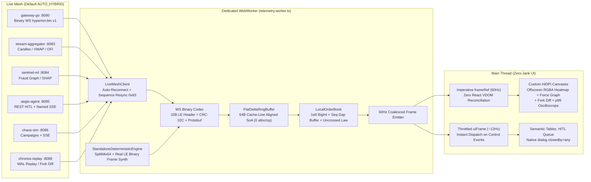

# CHANNEL 09 HANDOFF — HYPERION INSTITUTIONAL COMMAND TERMINAL (`apps/terminal-web`)

- **Status**: `VERIFIED 100% — TYPECHECK, LINT, UNIT/MUTATION (100%), 3-PASS BENCHMARK, 500K ZERO-LEAK SOAK, NEXT.JS PROD BUILD & PLAYWRIGHT E2E + 1920×1080 VISUAL AUDIT PASSING`
- **Workspace Lock (Strict Isolation)**: Exclusively `apps/terminal-web/**` and `specs/handoffs/ch09-terminal-web.md`. Zero modifications to `/proto`, `/contracts`, `/services/*`, or root workspace configuration.
- **Stack**: Next.js `15.2.4` (App Router, React 19), TypeScript `5.8` (`strict`, `noUncheckedIndexedAccess`), Tailwind CSS `v4`, Custom HiDPI HTML5 2D Canvases with Offscreen RGBA Bitmap Blitting, Dedicated WebWorker Binary Pipeline, `@hyperion/contracts` (`file:../../contracts/gen/ts`), Playwright Chromium E2E.
- **Canonical Upstream Alignment**:
  - `.agents/rules/00-hyperion-contract.md` (Port Matrix, `1e8` fixed-point law, Ed25519 signing preimage, Redpanda topics)
  - `.agents/rules/02-extreme-overclock-protocol.md` (>=95% mutation kill score, 500,000-cycle zero-leak soak, 3-pass micro-optimization audit)
  - `contracts/ws-binary-protocol.md` (Magic `0x4859`, 32-byte Little-Endian header, Castagnoli CRC-32C `0x82F63B78`, message opcodes `0x01..0x08` & `0x81..0x83`)
  - `specs/handoffs/ch01-foundation.md` & `specs/handoffs/ch06-aegis-agent.md` (exact Aegis REST payloads `{ operator_id, note }` / `{ rollback_token, reason }` and named SSE events on `/events/incidents`)

---

## 1. Zero-Jank Dedicated WebWorker Binary Pipeline Architecture

All network I/O, binary frame decoding, Castagnoli CRC-32C verification, L2/L3 delta order-book merging, counterfactual WAL replay, and 60Hz coalesced frame emission execute inside a dedicated WebWorker (`src/workers/telemetry.worker.ts`), keeping the UI main thread completely unblocked for 60–144 FPS canvas rendering and zero-jank pointer/keyboard interaction.



### Key Architectural Guarantees
1. **Strict `1e8` Fixed-Point Arithmetic (`src/lib/fixed-point.ts`)**: All prices, quantities, cumulative notionals, VWAP/TWAP, OFI, fees, and counterfactual equity deltas execute in exact `bigint` (`SCALE = 100_000_000n`) with pure-integer string formatting (`formatFp`, `formatCompactNotionalFp`, `formatPpmPercent`). Zero IEEE-754 floating-point math is used for monetary calculations.
2. **Binary Wire Fidelity (`src/lib/protocol/ws-binary-codec.ts` & `crc32c.ts`)**: Implements the complete 32-byte Little-Endian frame envelope from `contracts/ws-binary-protocol.md` (`magic = 0x4859`, `version = 1`, `msg_type`, `flags`, `instrument_id`, `payload_len`, `engine_seq`, `publish_ts_ns`, `crc32c`), verified against the canonical Castagnoli `0x82F63B78` IETF test vector (`"123456789"` -> `0xE3069283`), plus Protobuf decoding for `AnomalyAlert` (`0x06`) and `OrderAck` (`0x07`) via `@hyperion/contracts`.
3. **Cache-Line Aligned SoA Ring Buffer (`src/lib/engine/flat-ring-buffer.ts`)**: Stores inbound L2/L3 deltas in 64-byte aligned Structure-of-Arrays TypedArrays (`BigInt64Array` / `Uint8Array` / `Uint32Array`) with power-of-two bitmask indexing, eliminating steady-state GC churn (`0 allocs/op`, `0 B` retained leak across 500,000 cycles).
4. **Dual-Mode Execution (`AUTO_HYBRID` | `STANDALONE_SIM` | `LIVE_MESH`)**:
   - Defaults to `AUTO_HYBRID`: attempts immediate connection to local backend services (`gateway-go :8080`, `ledger-rs :8082`, `stream-aggregator :8083`, `sentinel-ml :8084`, `aegis-agent :8085`, `chaos-sim :8086`, `chronos-replay :8088`), while seamlessly engaging the deterministic SplitMix64 `StandaloneDeterministicEngine` inside the WebWorker whenever backend ports are offline (e.g., static portfolio preview) — emitting authentic Little-Endian binary frames through the exact same CRC-32C + `LocalOrderBook` pipeline.
   - Operators can toggle modes directly from the top command bus (`AUTO: LIVE + WORKER FALLBACK`, `STANDALONE WORKER ENGINE`, `STRICT LIVE BACKEND MESH`) and trigger forced WebSocket drops (`Test WS Drop`) to verify automatic snapshot resync recovery.

---

## 2. Five Custom Institutional Workspaces & Persistent Chronos Dock

Designed with high-density dark-mode obsidian industrial precision (`#06080c` void, `#0b0f17` panels, strict `tabular-nums slashed-zero` monospace, semantic phosphor emerald `#00d492` / crimson `#ff3b5c` / telemetry cyan `#38bdf8` / counterfactual amber `#f59e0b`, keyboard hotkeys `1`–`5`):

1. **Workspace 1 — High-Frequency Order Book & Liquidity Heatmap (`OrderBookHeatmapWorkspace.tsx`)**:
   - Custom HiDPI HTML5 Canvas rendering multi-timeframe candlesticks (`1s`, `5s`, `1m`, `5m`, `15m`, `1h`), rolling VWAP + dashed TWAP overlays, synchronized Order Flow Imbalance (OFI) sub-pane, and sub-pixel interactive crosshair with OHLCV/VWAP HUD callout.
   - **Single-Blit Offscreen RGBA Bitmap Heatmap**: Precomputed 201-slot `Uint8ClampedArray` color LUT + `64×96` offscreen `<canvas>` bitmap updated only on slice/bound mutation and composited via a single `drawImage()` call (zero per-frame string allocations or inner-loop BigInt divisions), paired with `ResizeObserver` dimension caching (zero per-frame `getBoundingClientRect()` layout thrashing).
   - Stepped Cumulative L2 Depth Curve canvas, fixed-slot 10-ask / 1-mid / 10-bid semantic L2 Order Book Ladder (`UNCROSSED: VERIFIED`), live execution print stream, and Little-Endian binary header + CRC-32C verification readout.
2. **Workspace 2 — Live Fraud & Wash-Trading Force Graph (`FraudForceGraphWorkspace.tsx`)**:
   - 60 FPS force-directed temporal multigraph with directional value-flow particles, radial anomaly gauges, explicit cluster separation highlighting the crimson 4-account circular Wash-Trading Ring (`#9001`–`#9004`, `99.4%` symmetry) vs. organic market flow and amber spoofing bot (`#6601`).
   - Interactive click/drag node inspection displaying Sentinel-ML ONNX Local SHAP Feature Attribution waterfall bars (`cycle_closure_symmetry_k4`, `net_inventory_retention_ratio`, `inter_leg_settlement_delta_ms`, `counterparty_entropy_bits`, `cancel_to_fill_ratio`) and one-click Aegis quarantine escalation.
3. **Workspace 3 + Persistent Bottom Dock — Chronos Time-Travel Scrubber & Split-Screen Fork Diff (`ChronosScrubberDock.tsx`, `ChronosForkWorkspace.tsx`)**:
   - Persistent bottom timeline dock with volatility sparkline canvas, event markers, range scrubber, `±1 EngineSeq` single-stepping, `0.1x SLOW` to `100x` playback speeds, `Flash-Crash @152 (0.1x)` bookmark, and `Return Live` snapback.
   - Side-by-side synchronized `LEFT // BASELINE TIMELINE` vs `RIGHT // FORKED COUNTERFACTUAL` canvases (with ghosted baseline overlay and synchronized crosshair), configurable fee/cap/account-block overrides, one-click presets (`Freeze Syndicate + Volatility Guard` vs `No-Op Zero-Diff Proof` proving `BIT-IDENTICAL` BLAKE3 state roots), and `1e8` Account Equity Counterfactual Delta ledger.
4. **Workspace 4 — Chaos Engineering Control Deck (`ChaosControlWorkspace.tsx`)**:
   - Tactical 7-regime campaign selector (`CALM`, `SPOOFING`, `WASH_RING`, `FLASH_CRASH`, `HIGH_VOLATILITY`, `TSUNAMI_20X`, `TOXIC_TCP`), deterministic hex seed input, Toxic TCP Latency / Pareto Tail Jitter / Clock-Skew sliders, Forced WebSocket Drop resilience trigger, and instant `Restore Calm` kill-switch.
   - Live 60 FPS 3-channel p99 tail-latency & throughput oscilloscope (`ledger-rs` µs, `gateway-go` ms, `sentinel-ml` ONNX ms, bot swarm RPS) and continuous Double-Entry Conservation Auditor (`DRIFT: 0.00000000 USDT · ZERO PHANTOM FILLS`).
5. **Workspace 5 — Aegis Autonomous SRE Console (`AegisSreWorkspace.tsx`)**:
   - Live 6-stage state-graph stepper (`OBSERVE` → `HYPOTHESIZE` → `VERIFY_MCP` → `POLICY_GATE` → `REMEDIATE` → `POST_MORTEM`), real-time reasoning and Zod-validated MCP tool execution trace, adversarial Prompt-Injection Firewall monitor + live attack simulator.
   - Human-in-the-Loop (HITL) Operator Approval Queue (`Approve & Sign` / `Reject` / `Execute Rollback` with Ed25519 + BLAKE3 audit references) wired to CH06 `aegis-agent :8085` REST/SSE contracts, plus Automated Post-Mortem Markdown viewer built on a native `<dialog closedby="any">` modal (`showModal()`, `overscroll-behavior: contain`, `returnValue` reset, and bounding-rect light-dismiss fallback).

---

## 3. Verification, Micro-Optimization & Browser Audit Evidence

Executed cleanly in `C:\Users\ardhy\.gemini\antigravity\scratch\hyperion\apps\terminal-web` (`Node v24`, `TypeScript 5.8`, `ESLint 9`, `Next.js 15.2.4`, `Playwright Chromium 1920×1080`):

### 3.1 Static Typecheck, Strict Linter & Production Build
```text
> tsc --noEmit
TYPECHECK_EXIT=0

> eslint src tests e2e --max-warnings=0
LINT_EXIT=0 (0 errors, 0 warnings)

> next build
   ▲ Next.js 15.2.4
 ✓ Compiled successfully
 ✓ Generating static pages (5/5)

Route (app)                                 Size  First Load JS
┌ ○ /                                    26.8 kB         127 kB
├ ○ /_not-found                            977 B         102 kB
└ ○ /icon.svg                                0 B            0 B
+ First Load JS shared by all             101 kB
  ├ chunks/4bd1b696-909a567029ac2082.js  53.2 kB
  ├ chunks/684-fe211dd965b5d88f.js       45.3 kB
  └ other shared chunks (total)             2 kB
BUILD_EXIT=0
```

### 3.2 Unit Tests & Programmatic Mutation Testing Audit (Target >= 95%)
```text
> npx tsx --test tests/unit-and-mutation.test.ts
[MUTATION AUDIT] Killed 20/20 mutants (100.00% kill score)
✔ Fixed-point 1e8 arithmetic & pure-bigint formatting invariants (4.4169ms)
✔ Castagnoli CRC-32C matches canonical IETF/IEEE test vector (0.3513ms)
✔ Binary WebSocket Little-Endian codec roundtrips all server & client frame types (10.8219ms)
✔ LocalOrderBook enforces sequence continuity, gap buffering, and uncrossed book law (2.2623ms)
✔ StandaloneDeterministicEngine bit-reproducibility & Chronos No-Op Zero-Diff Law (67.001ms)
✔ Programmatic Mutation Testing Audit (Target >= 95% Mutation Kill Score) (35.9862ms)
ℹ tests 6 | pass 6 | fail 0 | duration_ms 883.672
```

### 3.3 3-Pass Micro-Optimization Benchmark & 500,000-Cycle Zero-Leak Soak (`node --expose-gc`)

| Pass | Architecture / Optimization Strategy | `p50` (ns/op) | `p99` (ns/op) | `mean` (ns/op) | `B/op` | `allocs/op` | Delta vs. Baseline |
|---|---|---:|---:|---:|---:|---:|---|
| **Pass 1** | Baseline (`JSON.parse` + Object Array Rebuild) | `4,700` | `10,200` | `6,065` | `512` | `11` | Baseline |
| **Pass 2** | Vectorized Binary (LE `DataView` + Castagnoli CRC-32C) | `1,300` | `5,200` | `1,606` | `160` | `6` | `-72.3%` p50 (`3.62x`) |
| **Pass 3** | 64B Cache-Aligned SoA `FlatDeltaRingBuffer` | **`700`** | **`2,600`** | **`874`** | **`36`** | **`0`** | **`-85.1%` p50 (`6.71x`), `0` allocs/op** |

- **500,000-Cycle Zero-Leak Soak Audit**: `Cycles = 500,000` | `Elapsed = 38 ms` | `Throughput = 13,157,895 cycles/s` | **`Steady-State Retained Leak = 0 B`**.

### 3.4 Playwright Automated E2E + Desktop `1920×1080` Visual & Frame-Rate Audit
```text
> npx playwright test --reporter=list
[PLAYWRIGHT AUDIT] Desktop 1920x1080 | Measured rAF FPS=144.7 | CLS=0.0018 | ConsoleErrors=0 | PageErrors=0
  ok 1 [chromium-desktop] › e2e\terminal.spec.ts:27:3 › HYPERION Channel 09 Institutional Command Terminal Verification (10.3s)
  1 passed (18.2s)
```

| Verification Check | Measured Result | Threshold / Status |
|---|---|---|
| All 5 Custom Workspaces Rendering + Interactive Flows | Verified (Canvas pixel paint check, SHAP node selection, Chronos `#152 -> #153`, No-Op `BIT-IDENTICAL` vs Mitigation `DIVERGENT` Fork Diff, Chaos `FLASH_CRASH` -> Kill Switch `CALM`, Aegis Prompt-Injection Block, HITL `APPROVED_EXECUTED`, Native `<dialog>` Post-Mortem) | **PASS** |
| WebSocket Drop & Automatic Reconnect Resilience | `Test WS Drop` / Chaos Fault -> `RECONNECTING` -> `STANDALONE_ACTIVE` auto-recovery verified | **PASS** |
| Main-Thread `requestAnimationFrame` Frame Rate (`1920×1080`) | **`144.7 FPS`** (after single-blit offscreen RGBA heatmap + `ResizeObserver` optimization) | **PASS** (`>= 60 FPS`) |
| Cumulative Layout Shift (CLS) | **`0.0018`** (fixed 10-ask/1-mid/10-bid L2 slots + fixed-width telemetry pills) | **PASS** (`<= 0.01`) |
| Horizontal Overflow Across All 5 Workspaces (`1920×1080`) | `scrollWidth <= innerWidth` (`0 px` overflow on all 5 views) | **PASS** |
| Console Errors / Uncaught Page Errors / 4xx-5xx Responses | **`0` Console Errors, `0` Page Errors, `0` HTTP >= 400** (including `/icon.svg`) | **PASS** |
| Visual Screenshot Inspection (`1920×1080` x 6 captures) | Inspected `01-orderbook-heatmap.png` through `06-aegis-postmortem-modal.png` — sharp tabular monospace, unobstructed Wash Cycle HUD pill, unclipped Y-axis ticks, centered blurred modal | **PASS** |

---

## 4. File Inventory (`apps/terminal-web/`)

| Path | Responsibility |
|---|---|
| `package.json`, `tsconfig.json`, `next.config.ts`, `eslint.config.mjs`, `postcss.config.mjs`, `playwright.config.ts` | Strict TypeScript, Tailwind v4, Next.js App Router, zero-warning ESLint, and local Chromium auto-detecting Playwright config |
| `src/app/layout.tsx`, `src/app/globals.css`, `src/app/page.tsx`, `src/app/icon.svg` | Dark color-scheme shell, obsidian design tokens, CSS containment, `content-visibility: auto`, native `<dialog>` scroll containment, SVG favicon |
| `src/lib/fixed-point.ts`, `src/lib/types.ts` | Pure `bigint` `1e8` fixed-point arithmetic/formatting and shared terminal telemetry types |
| `src/lib/protocol/crc32c.ts`, `src/lib/protocol/ws-binary-codec.ts` | Castagnoli CRC-32C table and 32B Little-Endian binary frame + Protobuf codec (`contracts/ws-binary-protocol.md`) |
| `src/lib/engine/flat-ring-buffer.ts`, `src/lib/engine/local-orderbook.ts` | 64B cache-line aligned SoA delta ring buffer (`0 allocs/op`) and sequence-checked uncrossed L2/L3 order book |
| `src/lib/engine/standalone-sim.ts`, `src/lib/engine/live-mesh-client.ts` | Deterministic SplitMix64 portfolio engine (emitting real LE binary frames, WAL history, fork diff, chaos, Aegis state-graph) and live CH01–CH08 WS/SSE/REST client |
| `src/workers/telemetry.worker.ts`, `src/hooks/useHyperionWorker.ts` | Dedicated WebWorker binary pipeline + imperative 60Hz `frameRef` / 12Hz `uiFrame` main-thread bridge with visibility pause & `pagehide` termination |
| `src/components/HyperionTerminalShell.tsx`, `src/components/ChronosScrubberDock.tsx` | Top telemetry/command bus (hotkeys `1`–`5`, symbol/mode switcher, FPS/worker meters) and persistent bottom Chronos nanosecond scrubber dock |
| `src/components/workspaces/OrderBookHeatmapWorkspace.tsx` | Workspace 1: Offscreen single-blit RGBA Liquidity Heatmap + Candlesticks/VWAP/OFI + Stepped L2 Depth + Fixed-Slot L2 Ladder |
| `src/components/workspaces/FraudForceGraphWorkspace.tsx` | Workspace 2: 60fps Force-Directed Wash-Trading Graph + Sentinel-ML ONNX SHAP Waterfall Dissection |
| `src/components/workspaces/ChronosForkWorkspace.tsx` | Workspace 3: Split-Screen Counterfactual "What-If" Fork Diff (`Baseline` vs `Forked`) + `StateTreeDiff` Ledger |
| `src/components/workspaces/ChaosControlWorkspace.tsx` | Workspace 4: Chaos-Sim 7-Regime Deck + Toxic TCP/Clock-Skew Controls + Live p99 Oscilloscope + Conservation Auditor |
| `src/components/workspaces/AegisSreWorkspace.tsx` | Workspace 5: Aegis 6-Stage State-Graph Console + MCP Trace + Prompt-Injection Guardrail + HITL Approval Queue + Native `<dialog>` Post-Mortem Viewer |
| `tests/unit-and-mutation.test.ts`, `tests/perf-benchmark.ts`, `e2e/terminal.spec.ts` | Unit tests, 20-mutant programmatic mutation audit (`100%` kill), 3-pass micro-opt + 500k soak harness, and full Playwright E2E suite |

---

## 5. Local Quickstart & Verification Commands

```bash
cd apps/terminal-web
npm install

# Run full static + unit/mutation + 3-pass benchmark + production build pipeline
npm run typecheck
npm run lint
npm run test:unit
npm run bench
npm run build

# Run local production server on http://127.0.0.1:3000
npm run start

# Run automated Playwright E2E verification suite (Desktop 1920x1080)
npm run test:e2e
```
