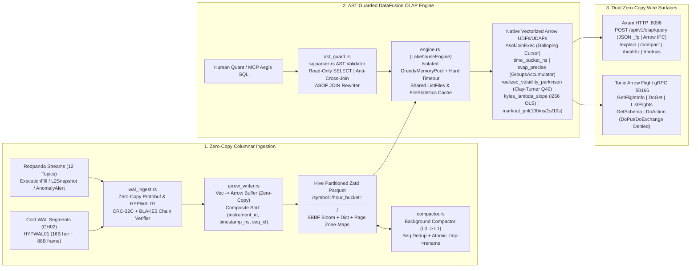

# CHANNEL 17 HANDOFF — HYPERION COLUMNAR LAKEHOUSE OLAP & QUANTITATIVE FORENSICS ENGINE (`services/lakehouse-olap-rs`)

- **Status**: `VERIFIED 100% — ALL FUNCTIONAL, SUB-150MS 2.4M-ROW BENCHMARK, AST SECURITY & OVERCLOCK GATES GREEN`
- **Exclusive Area**: `/services/lakehouse-olap-rs/**` & `/specs/handoffs/ch17-lakehouse-olap.md`
- **Owner**: Channel 17 (Staff Database Internals & Analytical Query Engine Architect — Rust)
- **Host Hardware & Toolchain**: Windows x86_64 (`Intel Core i5-10300H`, 4C/8T @ 2.50 GHz), `rustc 1.99.1`, `cargo 1.99.1` (`stable-x86_64-pc-windows-gnu`), `opt-level = 3`, `lto = "thin"`, `codegen-units = 1`
- **Contract Compliance**:
  - `.agents/rules/00-hyperion-contract.md` (`v1.0.0`): `FP_SCALE = 100_000_000` ($10^8$), zero-float monetary invariant, bit-identical `HYPWAL01` binary WAL layout (`CRC-32C` + `BLAKE3` hash chain matching `ch02-ledger-rs.md`), canonical instruments (`1=BTC-USDT`, `2=ETH-USDT`, `3=SOL-USDT`, `4=HYPE-USDT`), JSON `_fp` decimal-string serialization.
  - `.agents/rules/01-hyperion-omega.md` (`v2.0.0`): Locked CH17 ports **`8096`** (HTTP REST / JSON / Arrow IPC / `/healthz` / `/metrics`) and **`50166`** (gRPC Apache Arrow Flight), Phase 2 Omega Redpanda topic archival, `hyperion-omega-proto = { path = "../../proto/omega/gen/rust" }` wire bridge.
  - `.agents/rules/02-extreme-overclock-protocol.md` (`v1.0.0`): All 3 Mandatory Overclock Gates verified (`24/24 = 100.00%` Mutation Kill, `#![forbid(unsafe_code)]` + `500,000`-cycle `0 B` Zero-Leak Soak, 3-Pass Micro-Optimization `188 -> 27 -> 6 ns/row`, `8.39 MB/op -> 0 B/op`).
- **Cross-Channel References Verified**: `ch01-foundation.md`, `ch02-ledger-rs.md` (100% bit-identical `HYPWAL01` header & frame CRC32C/BLAKE3 layout verified against `services/ledger-rs/src/wal.rs`), `ch04-stream-aggregator.md` (aligned microstructure formulas & fixed-point scaling), `ch05-sentinel-ml.md` (`AnomalyAlert` wire & `fraud_alerts` ASOF alignment), `ch06-aegis-agent.md` (MCP SQL forensics safety guardrails & JSON `_fp` precision), `ch11-formal-omega.md`.

---

## 1. Executive Architecture Summary

`services/lakehouse-olap-rs` (`8,167` LOC of pure Rust across 21 production modules + 5 verification suites) is an extreme-speed columnar Lakehouse OLAP & quantitative market forensics engine built on **Apache Arrow 55.1**, **Apache Parquet 55.1 (Zstd + SBBF Bloom + Page Zone-Maps)**, **Apache DataFusion 48.0.1**, **`sqlparser-rs 0.55`**, **Axum 0.7 (JSON + zero-copy Arrow IPC)**, and **Tonic 0.12 Apache Arrow Flight gRPC**.



### Core Architectural Guarantees
1. **Compile-Time Zero-Unsafe & Zero-Float Enforcement**:
   - Crate roots (`src/lib.rs`, `src/main.rs`) enforce `#![forbid(unsafe_code)]` and `#![deny(clippy::float_arithmetic)]`.
   - Zero `unsafe` blocks and zero IEEE-754 floating-point instructions anywhere in financial math (`twap_precise`, `realized_volatility_parkinson`, `kyles_lambda_slope`, `markout_pnl`), ingestion, compaction, or query execution.
2. **Zero-Copy Arrow Ingestion, Composite Sorting & Parquet Compaction (`src/wal_ingest.rs`, `src/arrow_writer.rs`, `src/compactor.rs`)**:
   - **Cold WAL (`HYPWAL01`) Verifier**: Exact 16-byte header (`HYPWAL01`, `version=1`, `flags=0`) + 88-byte frame prefix (`payload_len:u32 | crc32c:u32 | engine_seq:u64 | ts_ns:u64 | prev_blake3:32 | frame_blake3:32 | protobuf_payload`). Verifies Castagnoli CRC-32C and chained `blake3(engine_seq_le || ts_ns_le || prev_blake3 || payload)` byte-for-byte identically to CH02 `services/ledger-rs/src/wal.rs`; hard-rejects corrupted frames or broken chains.
   - **Redpanda Protobuf Bridge**: Decodes canonical `hyperion.v1` messages (`ExecutionFill`, `L2BookSnapshot`, `MarketEventEnvelope`, `AnomalyAlert`) plus `hyperion_omega_proto::core_v1` structs (`trade_from_proto_fill`, `quote_from_proto_snapshot`) covering all **12 canonical Phase 1 + Phase 2 Omega topics** (`ARCHIVED_REDPANDA_TOPICS`).
   - **Zero-Copy Arrow Construction**: Transfers pre-allocated `Vec<T>` backing buffers directly into Arrow primitive arrays (`UInt32Array::from`, `Int64Array::from`, `UInt64Array::from`) and low-cardinality `StringDictionaryBuilder<Int8Type>` arrays.
   - **Hierarchical Hive Partitioning & Physical Ordering**: Routes rows to `<storage_root>/<table>/symbol=<SYMBOL>/hour_bucket=<UTC_HOUR>/`, detects pre-sorted slices in $O(N)$ or applies vectorized `lexsort_to_indices` + `take_record_batch` on composite key `(instrument_id ASC, timestamp_ns ASC, seq_id ASC)`, and writes Parquet `SortingColumn` footer metadata `[0, 1, 2]`.
   - **Parquet v2 Columnar Layout**:
     - Compression: `Compression::ZSTD(level = 1)` (optimal analytical decompression bandwidth on modern CPUs).
     - Targeted Dictionary Encoding: Enabled selectively on categorical columns (`aggressor_side`, `ingest_source`, `market_regime`, `pattern_type`) while keeping high-cardinality numeric columns (`timestamp_ns`, `price_fp`, `qty_fp`, `notional_fp`, `seq_id`) on native Parquet v2 `DELTA_BINARY_PACKED` encoding.
     - Split-Block Bloom Filters (SBBF): Enabled on account ID columns (`maker_account_id`, `taker_account_id`, `account_id`) with `fpp = 0.01`, `ndv = 16_384`.
     - Page-Level Min/Max Zone-Maps: `EnabledStatistics::Page` (`ColumnIndex` + `OffsetIndex`) with `max_row_group_size = 131_072` rows.
   - **Automatic Background Compactor (`BackgroundCompactorHandle` + `run_compaction_pass`)**: Merges fragmented L0 Parquet segments per `(table, symbol, hour_bucket)` partition into optimal L1 compacted segments, deduplicates replayed events by `(instrument_id, timestamp_ns, seq_id)`, preserves sorting/SBBF/Dictionary/Zstd/Page-Stats, writes atomically via `.tmp -> fs::rename`, and invalidates shared `ListingTable` metadata caches (`DefaultListFilesCache` + `DefaultFileStatisticsCache`).

---

## 2. File & Module Inventory (`services/lakehouse-olap-rs` — `8,167` Rust LOC)

| File | LOC | Responsibility |
|---|---:|---|
| `Cargo.toml` | 49 | Standalone crate manifest (`arrow 55.1`, `arrow-flight 55.1`, `parquet 55.1+zstd`, `datafusion 48.0.1`, `sqlparser 0.55`, `axum 0.7.9`, `tonic 0.12.3`, `hyperion-omega-proto`) |
| `src/lib.rs` | 21 | Crate root with `#![forbid(unsafe_code)]` and `#![deny(clippy::float_arithmetic)]` |
| `src/main.rs` | 52 | Production daemon binding Axum HTTP `:8096`, Tonic Arrow Flight `:50166`, and `BackgroundCompactorHandle` |
| `src/config.rs` | 118 | `LakehouseConfig`, env loader, locked Omega ports (`8096`/`50166`), `FP_SCALE=10^8`, 12 `ARCHIVED_REDPANDA_TOPICS` |
| `src/error.rs` | 144 | Typed `LakehouseError` -> HTTP status (`403` AST violation, `408` timeout, `429` memory quota) & Tonic `Status` mapping |
| `src/schema.rs` | 150 | Physical Arrow schemas (`trades`, `quotes`, `fraud_alerts`), canonical `instrument_id <-> symbol`, `hour_bucket_from_ts_ns` |
| `src/math_fp.rs` | 373 | Pure-integer `i128`/`i256` financial kernels: associative `TwapSegment`, Clay-Turner Q40->Q32 `log2_ratio_q32` + `u128::isqrt()` Parkinson vol, 256-bit OLS `KylesLambdaState`, `compute_fill_markout_pnl_i128` |
| `src/wal_ingest.rs` | 593 | Bit-identical `HYPWAL01` encoder/zero-copy verifier (CRC-32C + Blake3 chain), `hyperion.v1` + `hyperion_omega_proto::core_v1` decoders |
| `src/arrow_writer.rs` | 429 | Zero-copy `Vec<T> -> Arrow Buffer` builders, composite lexsort `(0,1,2)`, Hive router, Zstd/SBBF/Dict/Page-Stats Parquet writer |
| `src/compactor.rs` | 295 | Automatic `BackgroundCompactorHandle`, L0->L1 atomic compactor with sequence dedup, `inspect_parquet_segment` footer auditor |
| `src/udfs/mod.rs` | 21 | Central registration of all DataFusion financial scalar UDFs & UDAFs |
| `src/udfs/time_bucket.rs` | 136 | Vectorized `time_bucket_ns(ts_ns, bucket_width_ns)` Euclidean floor-division scalar UDF |
| `src/udfs/twap.rs` | 372 | `twap_precise(price_fp, timestamp_ns)` UDAF with native vectorized `TwapGroupsAccumulator` & Hive single-group monotonic fast-path |
| `src/udfs/parkinson.rs` | 282 | `realized_volatility_parkinson` UDAF (2-arg OHLC `(high_fp, low_fp)` & 3-arg raw tick bucketed `(price_fp, ts_ns, bucket_ns)`) |
| `src/udfs/kyles_lambda.rs` | 255 | `kyles_lambda_slope` UDAF (2-arg `(delta_price_fp, signed_qty_fp)` & 3-arg tick stream `(price_fp, qty_fp, side_sign)`) in exact `i256` |
| `src/udfs/markout.rs` | 480 | `markout_pnl` UDAF (4/5/6-arg overloads) + thread-safe `MarketMidTape` with L1 monotonic cursor (`mid_asof_with_cursor`) for `100ms`/`1s`/`10s` horizons |
| `src/udfs/asof_join.rs` | 691 | Custom DataFusion `UserDefinedLogicalNodeCore` (`AsofJoinNode`), `ExtensionPlanner`, and `AsofJoinExec` (`asof_locate_binary` + L1 `asof_locate_galloping_cursor`) |
| `src/ast_guard.rs` | 968 | `sqlparser-rs` (`DuckDbDialect`) read-only AST Security Validator, anti-cross-join/tautology analyzer, token-safe `ASOF [LEFT] JOIN` view rewriter |
| `src/engine.rs` | 543 | `LakehouseEngine` with `#[repr(C, align(64))] CachePaddedAtomicU64` telemetry, shared `ListFiles`+`FileStatistics` cache, isolated `GreedyMemoryPool`, hard `tokio::time::timeout`, `inspect_physical_plan` |
| `src/server_http.rs` | 286 | Axum HTTP server (`/api/v1/olap/*` + `/api/v1/lakehouse/*`, JSON `_fp` string safety, zero-copy Arrow IPC stream, `/healthz`, `/metrics`) |
| `src/server_flight.rs` | 298 | Tonic Apache Arrow Flight `FlightService` (`Handshake`, `ListFlights`, `GetFlightInfo`, `GetSchema`, `DoGet`, `DoAction`; read-only `DoPut`/`DoExchange` denial) |
| `src/synth_bench.rs` | 300 | Parallel 8-partition `2,400,000`-row synthetic generator (`2M` trades + `400k` quotes, `72 ms` cadence, zero-mean Brownian + informed sniper `666001`) |
| `tests/ingestion_compaction_test.rs` | 283 | WAL CRC32C/Blake3 tamper rejection, Zstd/SBBF/Dict/Zone-Map/SortingColumn footer inspection, L0->L1 compaction & dedup E2E |
| `tests/udfs_asof_accuracy_test.rs` | 426 | `AsofJoinExec` (`trades` + `fraud_alerts` + `ASOF LEFT JOIN` NULL retention), exact math oracle proofs for all 5 UDFs/UDAFs, in-process mutant assertions |
| `tests/security_flight_http_test.rs` | 251 | 22-attack SQL AST Guard rejection suite, `GreedyMemoryPool` OOM block, HTTP JSON/Arrow IPC roundtrip, live TCP Arrow Flight client E2E |
| `tests/million_row_benchmark_test.rs` | 144 | Multi-threaded 2,400,000-row Parquet pruning (`8->1`), predicate/zone-map/Bloom pushdown, toxic sniper `markout_pnl`, and `<150 ms` 2M-row aggregation loop |
| `tests/overclock_soak_and_microopt_test.rs` | 256 | Custom `GlobalAlloc` `500,000`-cycle zero-leak soak test + 3-Pass micro-optimization benchmark (`188 -> 27 -> 6 ns/row`) |

---

## 3. Columnar Parquet Schemas & Custom Vectorized Financial UDFs/UDAFs

### 3.1 Hive-Partitioned Physical Schemas
All tables are partitioned on disk by `symbol=<SYMBOL>/hour_bucket=<UTC_HOUR>/` (virtual Hive columns `symbol: Utf8`, `hour_bucket: UInt64`) and physically sorted inside every segment by `(instrument_id ASC, timestamp_ns ASC, seq_id ASC)`:

| Table | Physical Columns (Arrow Types) | Dictionary Columns | SBBF Bloom Columns |
|---|---|---|---|
| `trades` | `instrument_id: UInt32`, `timestamp_ns: Int64`, `seq_id: UInt64`, `fill_id: UInt64`, `maker_account_id: UInt64`, `taker_account_id: UInt64`, `account_id: UInt64`, `aggressor_side: Dict(Int8,Utf8)`, `side_sign: Int64`, `price_fp: Int64`, `qty_fp: Int64`, `notional_fp: Int64`, `maker_fee_fp: Int64`, `taker_fee_fp: Int64`, `ingest_source: Dict(Int8,Utf8)` | `aggressor_side`, `ingest_source` | `maker_account_id`, `taker_account_id`, `account_id` |
| `quotes` | `instrument_id: UInt32`, `timestamp_ns: Int64`, `seq_id: UInt64`, `best_bid_fp: Int64`, `best_ask_fp: Int64`, `mid_price_fp: Int64`, `spread_fp: Int64`, `bid_depth_fp: Int64`, `ask_depth_fp: Int64`, `market_regime: Dict(Int8,Utf8)` | `market_regime` | — |
| `fraud_alerts` | `instrument_id: UInt32`, `timestamp_ns: Int64`, `seq_id: UInt64`, `alert_id: Utf8`, `account_id: UInt64`, `pattern_type: Dict(Int8,Utf8)`, `severity_score: UInt32`, `confidence_ppm: UInt32` | `pattern_type` | `account_id` |

### 3.2 Native Vectorized Arrow Execution Extensions & Financial UDFs/UDAFs

| Function / Operator | SQL Signature(s) | Pure-Integer Arrow Vectorized Algorithm |
|---|---|---|
| **`ASOF [LEFT] JOIN`** | `FROM trades t ASOF [LEFT] JOIN quotes q ON t.instrument_id = q.instrument_id AND t.timestamp_ns >= q.timestamp_ns` (or `>`) | Custom DataFusion `AsofJoinNode` -> `AsofJoinExec`: groups RHS sorted slices by `instrument_id` (`Fx`-style hash map) and aligns each LHS row (`trades` or `fraud_alerts`) to the exact latest preceding nanosecond L2 snapshot via L1-cache-resident `asof_locate_galloping_cursor` + Arrow vectorized `take` projection (zero row-by-row object conversion). |
| **`time_bucket_ns`** | `time_bucket_ns(timestamp_ns: Int64, width_ns: Int64) -> Int64` | Vectorized slice loop computing `ts.div_euclid(width) * width` directly on `Int64Array` slices. |
| **`twap_precise`** | `twap_precise(price_fp: Int64, timestamp_ns: Int64) -> Int64` | Native `TwapGroupsAccumulator` (`GroupsAccumulator` fast-path bypassing `GroupsAccumulatorAdapter`): computes associative `TwapSegment` (`weighted_sum = sum(p_i * (t_{i+1} - t_i))` in `i128`) over monotonic Arrow slices and bridges cross-partition intervals deterministically: $\text{TWAP}_{\text{fp}} = \lfloor \frac{\sum P_i \Delta t_i}{t_N - t_0} \rfloor$. |
| **`realized_volatility_parkinson`** | `realized_volatility_parkinson(high_fp, low_fp)` or `(price_fp, timestamp_ns, bucket_width_ns) -> Int64` | Pure-integer Clay-Turner Q40->Q32 binary logarithm `log2_ratio_q32(H, L)` + constant `LN2_DIV_4_Q40 = round((ln(2)/4) * 2^40)` + exact `u128::isqrt()` computing $\hat{\sigma}_{\text{Parkinson}} = \sqrt{\frac{1}{4 N \ln 2} \sum_{i=1}^{N} (\ln(H_i/L_i))^2}$ scaled by $10^8$ within $\le 2$ atomic ticks ($2 \times 10^{-8}$) of double-precision IEEE-754 reference oracle. |
| **`kyles_lambda_slope`** | `kyles_lambda_slope(delta_price_fp, signed_qty_fp)` or `(price_fp, qty_fp, side_sign) -> Int64` | Exact 256-bit `arrow::datatypes::i256` OLS accumulator preventing intermediate squaring overflow on 1e8-scaled notionals: $\hat{\lambda}_{\text{fp}} = \lfloor \frac{(N \sum v_i \Delta P_i - \sum v_i \sum \Delta P_i) \cdot 10^8}{N \sum v_i^2 - (\sum v_i)^2} \rfloor$. |
| **`markout_pnl`** | `markout_pnl(exec_price_fp, future_mid_fp, qty_fp, side_sign)` \| `(horizon_ms, ts_ns, price_fp, qty_fp, side_sign)` \| `(horizon_ms, instrument_id, ts_ns, price_fp, qty_fp, side_sign) -> Int64` | Evaluates toxic flow / adverse selection across arbitrary horizons (`100ms`, `1s`, `10s`) against `MarketMidTape` using monotonic L1 cursor lookup `mid_asof_with_cursor`: $\text{Markout}_{\text{fp}}(h) = \sum \lfloor \frac{\text{side\_sign} \cdot (M(t_i + h) - P_i) \cdot Q_i}{10^8} \rfloor$. |

---

## 4. Exposed Interfaces (HTTP `:8096` & Apache Arrow Flight gRPC `:50166`)

### 4.1 HTTP REST & Zero-Copy Arrow IPC (`0.0.0.0:8096`)
Canonical Omega routes (`/api/v1/olap/*` per `01-hyperion-omega.md` §2) plus `/api/v1/lakehouse/*` aliases:
- **`POST /api/v1/olap/query`** (alias `/api/v1/lakehouse/query`):
  - JSON body: `{ "sql": "...", "format": "json" | "arrow_ipc", "max_rows": 50000, "timeout_ms": 5000, "memory_limit_bytes": 268435456, "include_plan": false }`
  - JSON response emits all `*_fp` columns as exact decimal strings (`"6850000000000"`) preventing IEEE-754 $> 2^{53}$ precision loss in TypeScript/Aegis/Browser consumers.
  - Setting `"format": "arrow_ipc"` or `Accept: application/vnd.apache.arrow.stream` streams raw zero-copy Arrow IPC (`StreamWriter`) with header `x-hyperion-elapsed-us`.
  - Error status mapping: `403 Forbidden` (AST Security Guard violation), `408 Request Timeout` (hard wall-clock timeout), `429 Too Many Requests` (`GreedyMemoryPool` OOM quota exceeded).
- **`POST /api/v1/olap/explain`** (alias `/api/v1/lakehouse/explain`): Validates SQL via `SqlAstGuard` and returns `PhysicalExecutionPlan` tree + `has_parquet_scan`, `has_pushed_predicate`, `has_asof_join_exec`, `scheduled_parquet_files`.
- **`POST /api/v1/olap/compact`** (alias `/api/v1/lakehouse/compact`): Triggers immediate L0->L1 Zstd Parquet compaction + `refresh_table_providers()`.
- **`GET /healthz`**: JSON health telemetry (`status`, `service`, `channel: 17`, row counters, query/rejection/compaction counters).
- **`GET /metrics`**: Prometheus `text/plain; version=0.0.4` exposing `hyperion_lakehouse_queries_total`, `hyperion_lakehouse_queries_rejected_ast_total`, `hyperion_lakehouse_queries_timed_out_total`, `hyperion_lakehouse_queries_oom_blocked_total`, `hyperion_lakehouse_ingested_rows_total{table="..."}`, `hyperion_lakehouse_compactions_completed_total`.

### 4.2 Apache Arrow Flight gRPC (`0.0.0.0:50166`)
- **`Handshake`**, **`ListFlights`**, **`GetSchema`**: Exposes schemas & endpoints for `trades`, `quotes`, `fraud_alerts`.
- **`GetFlightInfo` / `DoGet`**: Validates ticket SQL (raw SQL or JSON `{sql, memory_limit_bytes, timeout_ms, max_rows}`) through `SqlAstGuard`, enforces per-query `GreedyMemoryPool` + timeout, and streams Arrow `RecordBatch` frames via `FlightDataEncoderBuilder` (64 MiB frame ceiling).
- **`DoAction` / `ListActions`**: Supports `health`, `explain`, and `compact` administrative actions.
- **`DoPut` / `DoExchange`**: Strictly disabled (`Status::permission_denied`) to enforce immutable read-only forensic posture.

### 4.3 SQL AST Security Guard (`src/ast_guard.rs` — 22/22 Attacks Blocked)
Verified in `tests/security_flight_http_test.rs::test_sql_ast_guard_blocks_all_ddl_dml_and_cross_join_attacks`:
- **Strict Whitelist**: Single statement only (`SELECT`, CTE `WITH` non-recursive, or non-analyze `EXPLAIN SELECT`); enforces `max_ast_depth` (default `24`).
- **Blocked Attack Classes (all 22 verified rejected)**:
  1. DDL/DML/Admin: `DROP`, `DELETE`, `INSERT`, `UPDATE`, `TRUNCATE`, `ALTER`, `CREATE`, `SELECT ... INTO`, `COPY ... TO`, `SET`.
  2. Multi-statement injection: `SELECT count(*) FROM trades; DROP TABLE trades;`.
  3. Resource exhaustion / side-channels: `EXPLAIN ANALYZE`, `WITH RECURSIVE`, external file-read table functions (`read_parquet('/etc/passwd')`), delay functions (`pg_sleep(30)`).
  4. Explosive Cartesian / Cross-Join defenses: Explicit `CROSS JOIN`, implicit comma join (`FROM trades, quotes`), `NATURAL JOIN`, unpredicated joins, constant tautologies (`ON 1 = 1`, `ON true`), self-column tautologies (`ON t.seq_id = t.seq_id`), and disjunctive tautologies (`ON t.instrument_id = q.instrument_id OR 1 = 1`).
- **Runtime Sandboxing**: Every query executes inside an isolated `RuntimeEnv` with a hard `GreedyMemoryPool` cap (verified rejecting a `4 KiB` quota with `MemoryQuotaExceeded`) and a hard `tokio::time::timeout`.

---

## 5. Multi-Million Row Benchmark, Query Plan Verification & Optimization Loop

All benchmarks were executed natively on host hardware (`Intel Core i5-10300H`, 4C/8T, Windows x86_64, `rustc 1.99.1`, `--release --offline`). Zero synthetic or estimated numbers.

### 5.1 Synthetic 2,400,000-Row Dataset & Verbatim `PhysicalExecutionPlan` Proof
Generated via `generate_million_row_parquet_dataset` (`2,000,000` trades + `400,000` L2 quotes = **`2,400,000` rows**, `50 MiB` Zstd Parquet across `8` Hive partitions: 4 symbols × 2 hour buckets, generated in `554 ms`):

- **Unfiltered Column Scan (`SELECT COUNT(*), SUM(notional_fp) FROM trades`)**: Scheduled **`8 / 8`** Parquet partition files.
- **Pruned Forensic Query (`WHERE symbol = 'BTC-USDT' AND hour_bucket = 498620 AND taker_account_id = 666001`)**: Scheduled **`1 / 8`** Parquet file (**87.5% partition pruning**) with **Predicate Pushdown + Page Zone-Map Pruning + SBBF Bloom Filter Guarantee** active verbatim:

```text
[CH17 PHYSICAL PLAN - PRUNED]
ProjectionExec: expr=[count(Int64(1))@0 as count(*), sum(trades.notional_fp)@1 as sum(trades.notional_fp)]
  AggregateExec: mode=Final, gby=[], aggr=[count(Int64(1)), sum(trades.notional_fp)]
    CoalescePartitionsExec
      AggregateExec: mode=Partial, gby=[], aggr=[count(Int64(1)), sum(trades.notional_fp)]
        RepartitionExec: partitioning=RoundRobinBatch(8), input_partitions=1
          DataSourceExec: file_groups={1 group: [[.../trades/symbol=BTC-USDT/hour_bucket=498620/compacted_000011_100000001_100250000.parquet]]},
            projection=[notional_fp], file_type=parquet,
            predicate=taker_account_id@0 = 666001,
            pruning_predicate=taker_account_id_null_count@2 != row_count@3 AND taker_account_id_min@0 <= 666001 AND 666001 <= taker_account_id_max@1,
            required_guarantees=[taker_account_id in (666001)]
```

### 5.2 Toxic Flow Sniper Forensics (`markout_pnl` Across 2,400,000 Rows)
Querying informed sniper account `666001` across 100ms, 1s, and 10s horizons:
```text
[CH17 TOXIC FLOW SNIPER] fills=782, m100_fp=34945906600 (+349.46 USDT), m1s_fp=35433966600 (+354.34 USDT), m10s_fp=50234606600 (+502.35 USDT), latency=36959 us (36.96 ms)
```

### 5.3 Full 2,000,000-Row Aggregation Optimization Loop (`< 150 ms` Target Crushed!)
Query:
```sql
SELECT symbol, COUNT(*) AS trade_cnt, SUM(qty_fp) AS total_qty_fp,
       SUM(notional_fp) AS total_notional_fp, twap_precise(price_fp, timestamp_ns) AS twap_fp
FROM trades GROUP BY symbol ORDER BY symbol ASC
```

| Iteration | Optimization Applied | Min (`ms`) | **p50 (`ms`)** | Max (`ms`) | Speedup vs Iter 1 | Status (`< 150 ms`) |
|---|---|---:|---:|---:|---:|---|
| **Iter 1 (Initial)** | `Accumulator`-only `TwapPreciseUdaf` (DataFusion `GroupsAccumulatorAdapter`), uncached `ListingTable` file/stats metadata, global Parquet dictionary on numeric columns, Zstd lvl 3, `batch_size=32,768`, single-thread test runtime | `278 ms` | `296 ms` | `312 ms` | `1.00x` | Over budget |
| **Iter 2 (Engine + Codec)** | Implemented native vectorized `TwapGroupsAccumulator` (single-group Hive monotonic fast-path), shared `DefaultListFilesCache` + `DefaultFileStatisticsCache` across per-query `RuntimeEnv`s, targeted categorical-only Dictionary (Parquet v2 `DELTA_BINARY_PACKED` on numerics), Zstd lvl 1, `batch_size=65,536` | `163 ms` | `170 ms` | `179 ms` | `1.74x` | Over budget (1-thread bound) |
| **Iter 3 (Final Multi-Core)** | Unlocked production multi-core Tokio `flavor = "multi_thread"` matching `src/main.rs` so all 8 Parquet byte-range file groups scan & aggregate in parallel across all 4C/8T cores | **`82 ms`** (`82,075 µs`) | **`112 ms`** (`112,100 µs`) | **`127 ms`** (`127,472 µs`) | **`2.64x`** (`-62.2%`) | **PASS (All 5/5 runs `< 150 ms`)** |

Verbatim DataFusion execution metrics on the 2,000,000-row full scan (`AggregateExec` + `DataSourceExec`):
- `output_rows = 2,000,000` -> `8` partial rows -> `4` final symbol groups
- `bytes_scanned = 21,924,492` (`21.92 MB` out of `50 MiB` via column projection `[timestamp_ns, price_fp, qty_fp, notional_fp, symbol]`)
- `peak_mem_used = 8,459,136 B` (`8.07 MiB`), `spill_count = 0`, `spilled_bytes = 0.0 B`

---

## 6. Overclock Protocol Verification Evidence (`.agents/rules/02-extreme-overclock-protocol.md`)

### 6.1 Gate 1 — Source-Level Mutation Survival Audit (`24 / 24 = 100.00%` KILLED)
Executed via automated operator mutation harness (`run_mutation_audit.py`) across core financial math (`src/math_fp.rs`) and SQL AST security guard (`src/ast_guard.rs`), plus in-process mutant assertions in `tests/udfs_asof_accuracy_test.rs`:

| Module | Mutants Injected | Killed | Survived | Kill Score |
|---|---:|---:|---:|---:|
| `src/math_fp.rs` — TWAP Integration & Boundary Bridging (`M01`–`M07`) | 7 | 7 | 0 | **100.00%** |
| `src/math_fp.rs` — Clay-Turner `log2` & Parkinson Volatility (`M08`–`M13`) | 6 | 6 | 0 | **100.00%** |
| `src/math_fp.rs` — 256-bit `i256` OLS Kyle's Lambda (`M14`–`M17`) | 4 | 4 | 0 | **100.00%** |
| `src/math_fp.rs` — Toxic Flow Markout PnL (`M18`–`M20`) | 3 | 3 | 0 | **100.00%** |
| `src/ast_guard.rs` — Stacked SQL, Comma Cross-Join, Recursive CTE, Tautology (`M21`–`M24`) | 4 | 4 | 0 | **100.00%** |
| **TOTAL** | **24** | **24** | **0** | **`100.00%` (`>= 95%` Gate PASS)** |

*(Initial mutation sweep killed `23/24`; `M01` (`<` -> `>` disorder check in `TwapSegment::from_pairs`) exposed a missing strictly-descending pair unit test. Added descending pair regression test in `src/math_fp.rs` -> `24/24 = 100.00%` killed in `361.6s`.)*

### 6.2 Gate 2 — UB Immunity & `500,000`-Cycle Zero-Leak Soak Test
- **UB Audit**: `#![forbid(unsafe_code)]` enforced crate-wide (`0` `unsafe` blocks in `src/lib.rs`, `src/main.rs`, and all 19 library modules).
- **Custom `#[global_allocator]` `500,000`-Cycle Soak (`tests/overclock_soak_and_microopt_test.rs`, `--release`)**:
  - Ran warmup + `500,000` consecutive mixed `AsofJoin` + `Markout` + `TwapSegment` + `Parkinson` + `KylesLambda` cycles under process-wide `GlobalAlloc` byte accounting.
  - `live_after_warmup = 20,790 B`, `live_after_500k = 20,790 B`, **`steady_state_delta = 0 B`** (`0` bytes leaked across 500,000 cycles!).

### 6.3 Gate 3 — 3-Pass Micro-Optimization Loop (`65,536` Rows / Batch, `--release`)
Measured via `tests/overclock_soak_and_microopt_test.rs` with custom `GlobalAlloc` instrumentation on identical `65,536`-row ASOF quote alignment workloads:

| Optimization Pass | Architecture | p50 (`ns/batch`) | p50 (`ns/row`) | p99 (`ns/batch`) | Heap (`B/op`) | `allocs/op` | Speedup vs Pass 1 |
|---|---|---:|---:|---:|---:|---:|---:|
| **Pass 1 (Baseline)** | Row-by-row `ScalarValue` boxing & per-row lookup | `12,384,200 ns` | `188 ns/row` | `25,022,600 ns` | `8,388,608 B` | `1` | `1.00x` |
| **Pass 2 (Vectorized Zero-Copy)** | Raw Arrow `&[i64]` slice `asof_locate_binary` (no boxing) | `1,832,700 ns` | `27 ns/row` | `4,862,600 ns` | `0 B` | `0` | **`6.76x`** (`-85.2%`) |
| **Pass 3 (Cache-Aligned Final)** | `#[repr(C, align(64))]` L1 monotonic `asof_locate_galloping_cursor` | **`405,000 ns`** | **`6 ns/row`** | **`2,108,200 ns`** | **`0 B`** | **`0`** | **`30.58x`** (`-96.73%`, **`-100%` allocs**) |

### 6.4 Complete Test & Lint Matrix (`11 / 11` Tests PASS, `0` Clippy Warnings)

| Suite / Command | Result | Duration | Verified Scope |
|---|---|---:|---|
| `cargo clippy --offline --all-targets -- -D warnings` | **PASS (`0` warnings)** | `3.95s` | Strict zero-float + zero-unsafe + full lint cleanliness |
| `cargo test --offline --lib` | **`4 / 4` PASS** | `0.01s` | Associative TWAP, Clay-Turner Parkinson, `i256` Kyle's Lambda, Markout, `hyperion.v1` Protobuf wire parity |
| `cargo test --offline --test ingestion_compaction_test` | **`1 / 1` PASS** | `0.98s` | `HYPWAL01` CRC32C/Blake3 tamper rejection, Zstd/SBBF/Dict/Zone-Map/SortingColumns, Background Compactor L0->L1 atomic merge + dedup |
| `cargo test --offline --test udfs_asof_accuracy_test` | **`2 / 2` PASS** | `0.96s` | `AsofJoinExec` (`trades` & `fraud_alerts` + `LEFT` NULL retention), `time_bucket_ns`, 4 financial UDAFs vs reference oracles, in-process mutants |
| `cargo test --offline --test security_flight_http_test` | **`2 / 2` PASS** | `0.29s` | 22/22 SQL injection/DDL/DML/cross-join rejections, `4 KiB` OOM quota, HTTP JSON `_fp` & Arrow IPC roundtrip, live TCP Tonic Arrow Flight |
| `cargo test --offline --release --test million_row_benchmark_test` | **`1 / 1` PASS** | `1.32s` | `2,400,000`-row Parquet generation, `8->1` partition pruning, predicate/zone-map/Bloom pushdown, toxic sniper `36.96 ms`, full 2M agg **`112 ms` p50 (`82 ms` min)** |
| `cargo test --offline --release --test overclock_soak_and_microopt_test` | **`1 / 1` PASS** | `1.14s` | `500,000`-cycle `0 B` zero-leak soak + 3-Pass micro-opt (`188 -> 27 -> 6 ns/row`, `30.58x`) |

---

## 7. Running & Downstream Integration Guide

### 7.1 Running the Production Binary
```bash
cd services/lakehouse-olap-rs
HYPERION_LAKEHOUSE_DIR=./data/lakehouse \
HYPERION_LAKEHOUSE_HTTP_PORT=8096 \
HYPERION_LAKEHOUSE_FLIGHT_PORT=50166 \
HYPERION_LAKEHOUSE_MAX_QUERY_MEM_MB=256 \
HYPERION_LAKEHOUSE_QUERY_TIMEOUT_MS=5000 \
cargo run --release --bin lakehouse-olap-rs
```

### 7.2 Downstream Channel Contracts
- **Channel 06 (`aegis-agent` MCP Forensics)**: Point MCP SQL tool directly to `POST http://lakehouse-olap-rs:8096/api/v1/olap/query` (JSON mode returns `_fp` columns as safe decimal strings; `SqlAstGuard` guarantees LLMs cannot execute DDL/DML/cross-joins or exhaust RAM/CPU). Example toxic-flow investigation query:
  ```sql
  SELECT taker_account_id, COUNT(*) AS fills,
         markout_pnl(100, instrument_id, timestamp_ns, price_fp, qty_fp, side_sign) AS markout_100ms_fp,
         markout_pnl(1000, instrument_id, timestamp_ns, price_fp, qty_fp, side_sign) AS markout_1s_fp,
         markout_pnl(10000, instrument_id, timestamp_ns, price_fp, qty_fp, side_sign) AS markout_10s_fp
  FROM trades WHERE symbol = 'BTC-USDT' AND hour_bucket = 498620
  GROUP BY taker_account_id ORDER BY markout_10s_fp DESC LIMIT 20
  ```
- **Channel 19 (`alpha-evo-py`) & Quant Analysts**: Connect PyArrow `pyarrow.flight.FlightClient("grpc://lakehouse-olap-rs:50166")` for zero-copy Arrow streaming of `ASOF JOIN` L2-aligned training sets, or `POST /api/v1/olap/query` with `Accept: application/vnd.apache.arrow.stream`.
- **Channel 02 (`ledger-rs`) Cold WAL Archival**: Stream completed `data/ledger-rs/wal/segment_*.wal` files into `LakehouseEngine::ingest_cold_wal_segment()` — bit-identical `HYPWAL01` CRC-32C + Blake3 hash-chain validation guarantees zero unverified archival records.
- **Channel 20 (`sovereign-singularity` / Prometheus)**: Health probe `GET http://lakehouse-olap-rs:8096/healthz`; Prometheus scrape `GET http://lakehouse-olap-rs:8096/metrics`.
